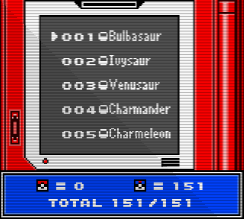
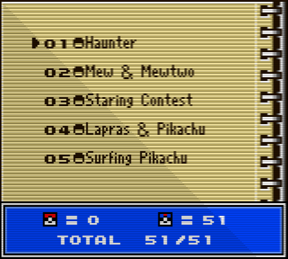
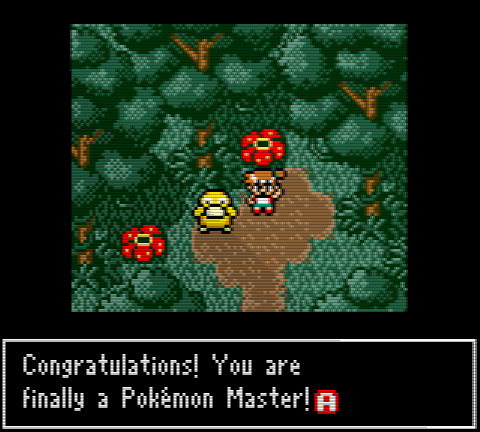
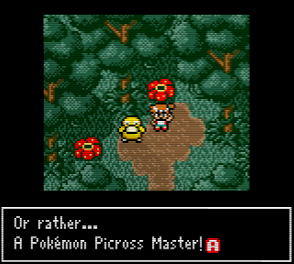
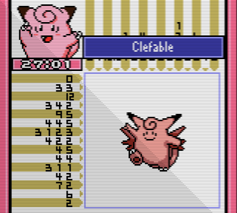
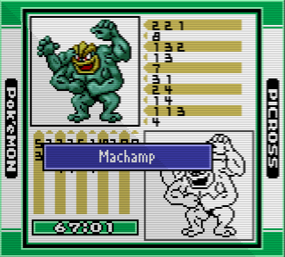
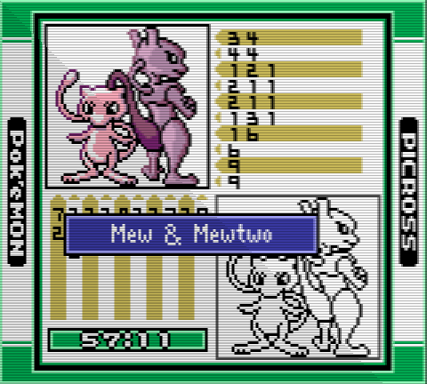
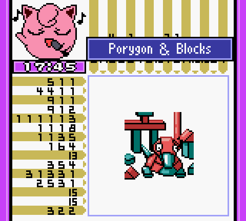
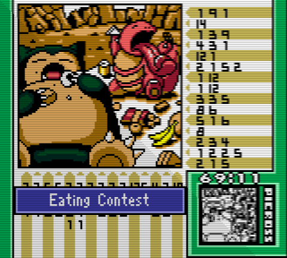
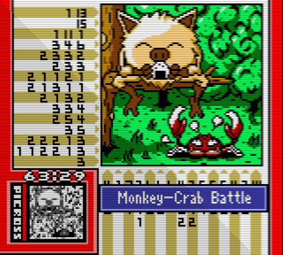

What a doozy...

Now, I'll clear up confusion by stating that the game is not BAD... not at all. It's just surprisingly intensive for a Picross game. I will elaborate on the completion requirements as there are three "endings" to achieve, none of which require true 100% completion (pictured above). No, you don't get anything for it, so DON'T be me.

So... it's another Jupiter-developed Picross game. It controls similarly to its predecessors Mario's Picross and Picross 2, as there was no need to innovate on that front. All 202 'stages' (each 'stage' may contain 1 or 4 puzzles to complete) have a unique 'PAR TIME' that you must reach to receive the Great Ball marker and advance to the next hub of stages. This is the primary source of its difficulty and leaves very little room for error, but you only need to do so on less than half of the puzzles. If I had to guess, there are at least 450 puzzles within all 202 stages.

The game's greatest strength is its presentation. Even Ken Sugimori was involved as a Graphics Supervisor, according to its credits. The first 151 puzzles are standard images of every Kanto Pokémon, but the harder 'Safari Picross' mode rewards you with awesome illustrations of interactions between various Pokémon! That alone made it worth it for me and it's a shame that, due to the ROM's association with the Gigaleaks, its assets can't be hosted in isolation. Alongside is a simple little story that follows an unnamed Trainer's journey through the Kanto region, assisted by his friends Bill and Misty.

Unfortunately, the music sucks ass. All of the stage BGMs are incredibly annoying. Mario's Super Picross stays on top, I guess! Anyways...

### Endings:

+ Ending #1: Reach the par time for 81 stages in Pokémon Picross mode (8*10 plus Mew). Opens Safari Picross mode.
+ Ending #2: Complete all 151 stages in Pokémon Picross mode. Misty suggests you complete Safari Picross mode.
+ True ending: Complete all 51 stages in Safari Picross mode.
+ Time it took to 100%: About 20 hours

### Favorite puzzle images:

### GIVE UP:

### If you're interested:

+ [Romhacking.net English patch](https://www.romhacking.net/translations/5702/)
+ [TCRF article](https://tcrf.net/Pok%C3%A9mon_Picross_(Game_Boy_Color))

