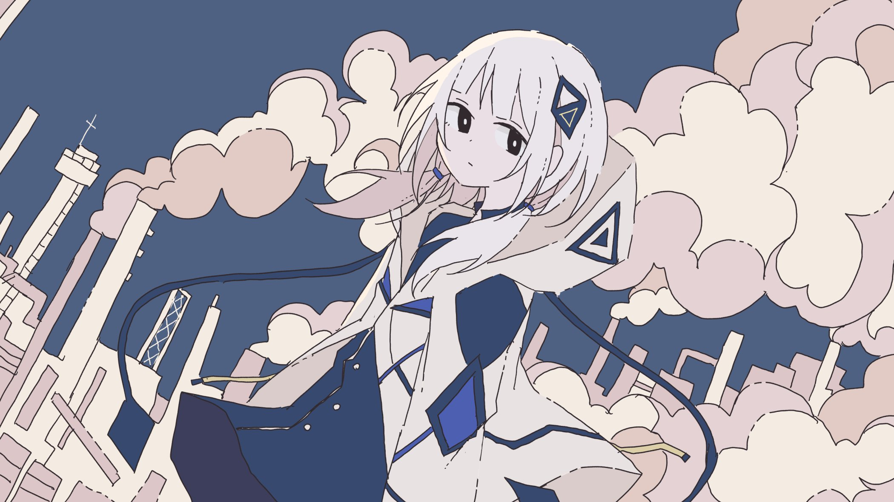

Art by Akasia

"君と咲いていたいと (I want to bloom alongside you)"

The little CEVIO AI vocal that could... it's KAFU (可不), the 'musical isotope' form of utaite KAF. A character of a character. Excluding KAF's own skills and popularity, we can attribute KAFU's success to her heavy marketing campaign: 20+ songs commissioned from VOCALOID musicians all across Japan. While many remain her most popular songs, a simple Youtube search (or long music sessions with your friend) would show she's getting healthy use from producers old and new. It's nice!

(Said friend purchased KAFU a few months ago, so I've since become a fan. I'm currently egging her on to complete a cover or an original track.)

Anyway, I couldn't find a comprehensive KAFU demo playlist on Youtube, [so I put one together tonight.](https://youtube.com/playlist?list=PLD2oznnZicmBFR9sXjJ0RqiN4XZWfQ2Ui) I hadn't heard quite a few of them before; it might be that KAFU and CEVIO as a software are simply more popular in Japan (as opposed to its rival[?], SynthV). Just wanted to share the playlist and some songs I consider highlights.

### Highlights

1. [Yunosuke - Hana to Nare.](https://www.youtube.com/watch?v=XqKbuEDvaf8&list=PLD2oznnZicmBFR9sXjJ0RqiN4XZWfQ2Ui&index=13) I am a huge fan of Yunosuke and his troupe, so this was a given... the lyrics are intimate and thoughtful, beautiful PV, obsessed with that gated piano.
2. [Tsumiki - Phony.](https://www.youtube.com/watch?v=9QLT1Aw_45s&list=PLD2oznnZicmBFR9sXjJ0RqiN4XZWfQ2Ui&index=21) What I'd call the most 'utaite-friendly' song, both in sound and visuals. Very catchy and has that popular disillusioned edge.
3. [Police Piccadilly - Insolent Applause.](https://www.youtube.com/watch?v=m10mNB8L9Kw&list=PLD2oznnZicmBFR9sXjJ0RqiN4XZWfQ2Ui&index=4) It's Police Piccadilly, that's all I can say. Short but solid.
4. [Mizuno Atsu - Hitori Yogari.](https://www.youtube.com/watch?v=HPR9IS5PU2U&list=PLD2oznnZicmBFR9sXjJ0RqiN4XZWfQ2Ui&index=10) Cutest PV, reminiscent of Melty Land Nightmare in concept. A cute duet by the producer and KAFU.
5. [DIVELA - My Doppleganger.](https://www.youtube.com/watch?v=QggCIx9mHwc&list=PLD2oznnZicmBFR9sXjJ0RqiN4XZWfQ2Ui&index=26) Has my favorite illustration of all of them. Nice rock song that touches on KAFU's identity.
6. [164 - Zenbu Zenbu Zenbu.](https://www.youtube.com/watch?v=GeGlTNfPCTg&list=PLD2oznnZicmBFR9sXjJ0RqiN4XZWfQ2Ui&index=23) KAFU has an interesting flow and rhythm to her vocals. Love the samples too. Memorable and melancholy.
7. [R Sound Design - Retropolis.](https://www.youtube.com/watch?v=YGlAWg1YmQ8&list=PLD2oznnZicmBFR9sXjJ0RqiN4XZWfQ2Ui&index=11) If this was an instrumental track, I would've sworn it was Michael Kelly. Inoffensive, relaxing. 