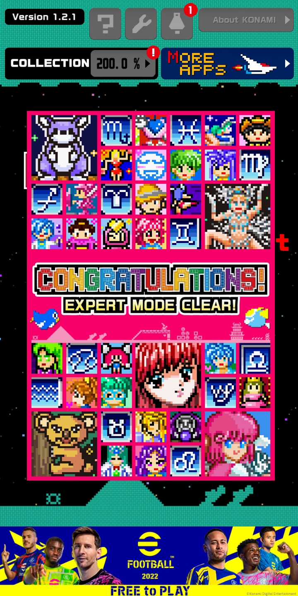
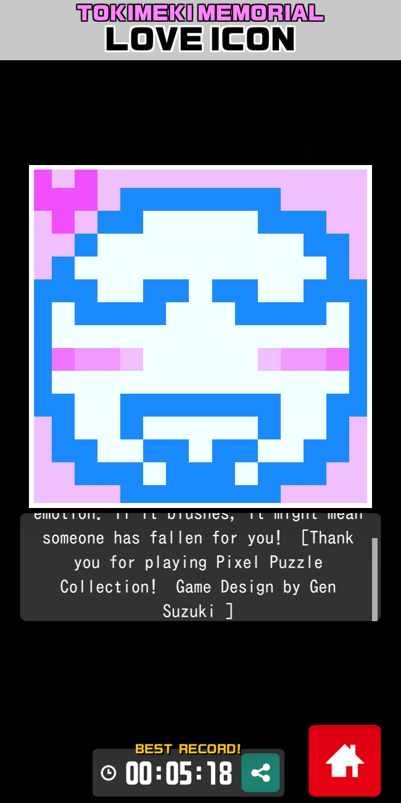
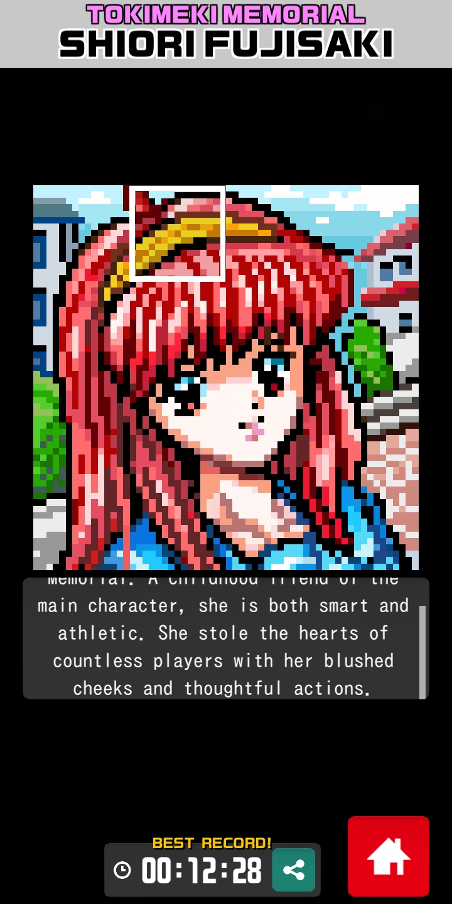
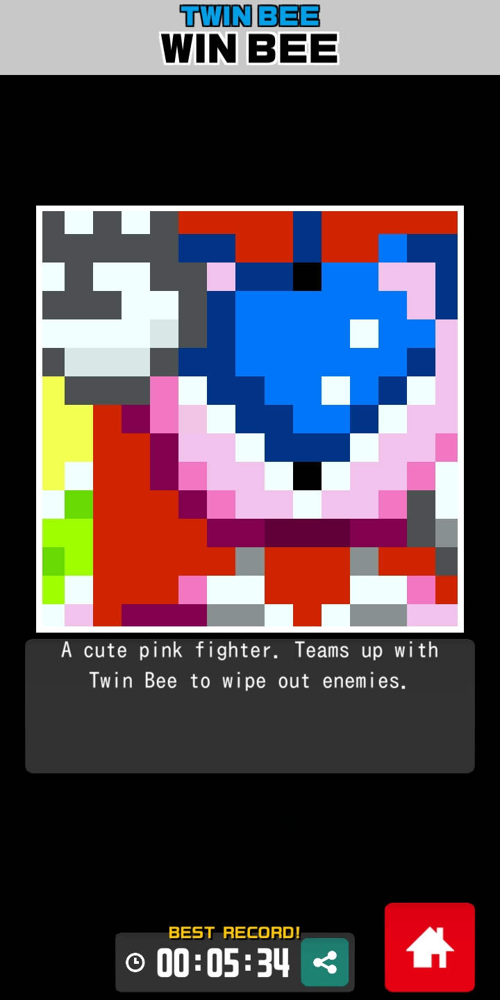
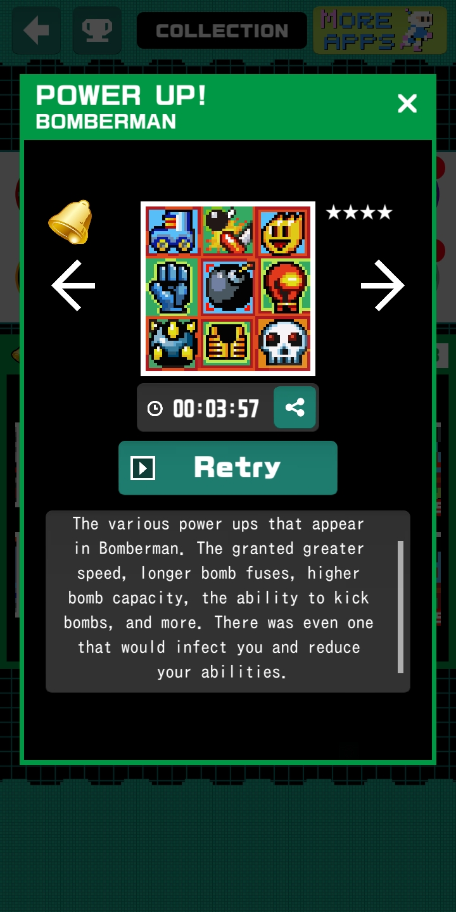
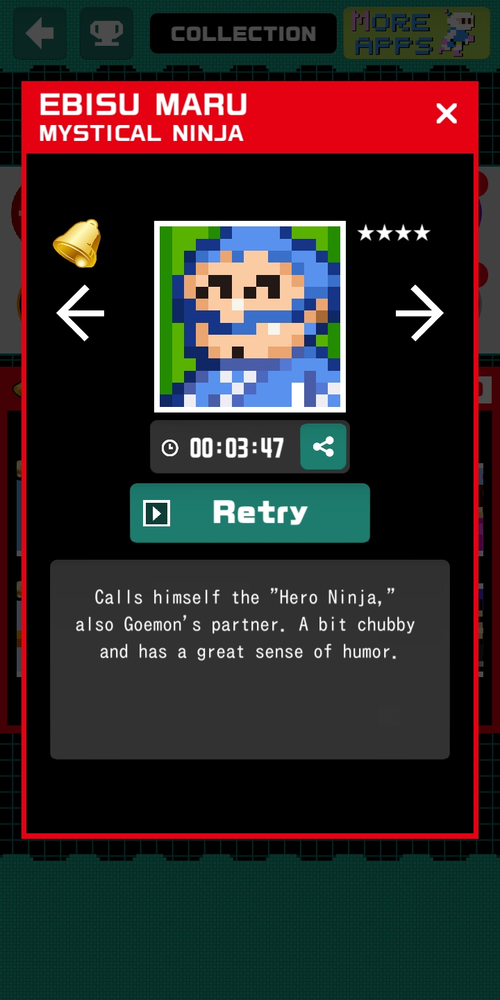
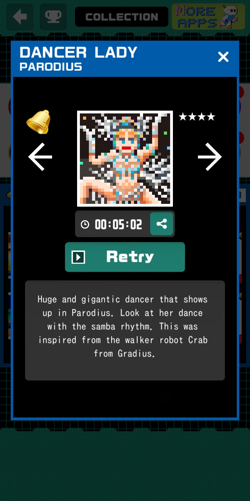

Lord forgive me for playing so much Picross...

It's another "review" type of blog... I'm sorry, but it was a file I've had collecting dust for a bit. Haven't been in the mood to write either.

This was a behemoth of an achievement that began Halloween night, 2021; I had installed it on my phone to kill some time at my grandparents' that evening and became determined to see it to the bitter end. I quickly found it to be a time-consuming effort, mainly due to the game's special 'boss puzzles' (note: 1 boss puzzle image is composed of 16 puzzles) only refreshing once every 3 hours. So, fast forward to Feb. 1, 2021, I "100%" the game, completed all 500 of its fucking puzzles... only to discover there's an Expert Mode that has you replay all 500 and some extras without the X marking tool! I was like, alright, I'll take you on!! Turns out it wasn't as hard as it sounded, especially since all of the puzzles are only 15x15. Boss puzzles are no longer restricted by a timer either. There's a few bullshit puzzles, but nothing I was losing sleep over... or so I thought until I completed the game. See, 1000+ puzzles racks up a lot of playtime over 5.5 months, so I was surprised by my freedom inbetween everyday activities post-completion. Gahhh, I need to put down these stupid puzzles for a little while. Play your puzzle games casually and in moderation, everyone. Do everything in moderation.

If you're looking for a free puzzle app with plenty of playtime, this is a good contender. It plays comfortably on a phone screen and has okay puzzle art overall. Also, if you're a Konami fan, you'll enjoy seeing localized names and descriptions for games no one has heard of lol. [Some random Konami BGMs play](https://www.youtube.com/playlist?list=PLe0g5O0KnKP7ckotzJoHm_sBeRy6p2ULF), but I usually played without sound...

### Some puzzles

If you're interested: [Konami's US page for the app](https://www.konami.com/games/us/en/products/pixelpuzzle/)
