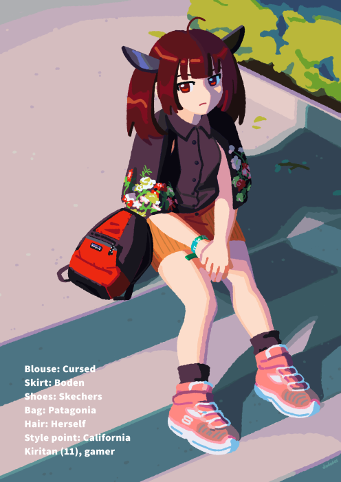
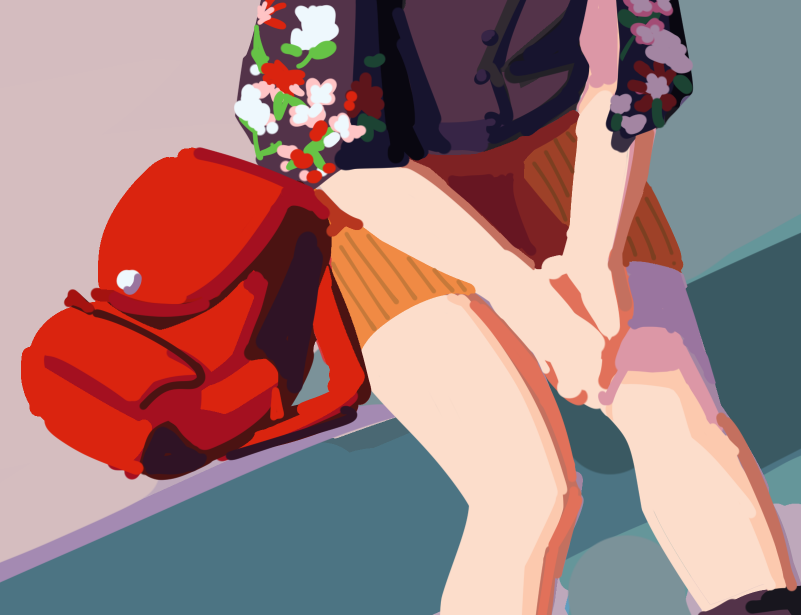

Galasynth 2024, a MASSIVE free Vocal synth fashion collab, released on 9/20 on Itch! Yay! I recommend viewing the collab before reading.

Online viewer || Itch download page

### Thrifttan

Tohoku Thrifttan. It was planned from the start to use Kiritan for this collab, even if I was the only person using a CEVIO character. Few CEVIOs appeared after all, so I'm proud to have represented her. "Thrifted clothing" was also my first idea. The top image includes my first ideations for the theme, with the Kiritans on the far left being vague recollections of items I saw at my usual thrift. I know for sure the painted Vans were my memory of a pair with Kanto Pokemon on them lol. I've thrifted for a few years now, good way to keep down on waste, find unique materials and designs, all that. Why not celebrate it.

Anyway, this was developed while I was on vacation in Canada. Nothing about the work stands out as Canadian, but all of Kiritan's clothing are based on items I saw at various thrifts there.

    1. Possibly the worst blouse I've ever seen. It left a strong impression on Tip and I and we agreed it was the one. 
    2. I photographed the shoe rack to choose a pair as I drafted my piece. I went with the beat up pink Skechers since their bulkiness is cute and the pink matched the small flowers in the cursed blouse.
    3. A strange belt I knew wouldn't be visible with Kiritan's pose. It was converted to a strange bracelet. Kinda regret not buying it.
    4. A cute corduroy skirt that I didn't catch the brand of. I went on a wild vintage search for a match and settled on a very similar Boden.

The backpack was the only thing not in a Canadian thrift, because originally it wasn't going to be a branded backpack at all. I thought of making it a randoseru like the black one Kiritan wears, but that's not in the spirit of this project. So I hopped around a bunch of resell sites to see what vintage red bags could match the other articles in location and timeframe. I found a lightly used patagonia--Californian brand, like Skechers--and rolled with that after two mystery bags I couldn't find brands for.

The outdoor scene and text profile reference FRUiTS, which famously featured DIY-savvy teenagers, imported brands, and fucked lighting situations. (marshmallow-manju, who drew CUL and Galaco for the collab, also referenced FRUiTS!) I imagined Kiritan is at an age that she'd begin to explore fashion, though she'd do it awkwardly and frugally, hence the heavy thrifting. And that one day, in a world where I worked for FRUiTS for some reason, I caught her in this fit.

Last, those cast shadows. They were nonsensical in my rough painting and not having a useful reference when painting over drove me up the wall. So I did what any sane artist would and mimicked Kiritan's pose on my bed, positioned my desk lamp in the same angle as the image's lighting, and photographed my reflection in my giant TV screen. Nothing beats direct observation! (For your safety, a photo is not included)

### Galasynth

I'm deeply thankful to the Galasynth team for this beast of a project. They and the other project artists were always pleasant and encouraging. Maybe too forgiving with deadlines for a project of this scale.

Many artists on board mentioned it was their first collab, and that's a huge step forward! So while it was surely difficult to manage, Galasynth provided an opportunity and community that isn't often available to smaller or less experienced artists. Passion projects like these should celebrate work of all levels.

### Some pieces I love:

+ [Hikari_kiiro's](https://twitter.com/HikariKiiro) Miku/Luka/Rin. Hot pink lighting's sick. The outfits and art belong in Project Sekai for Vivid Bad Squad.
+ [peedee's](https://twitter.com/pierrotsdoll) qipao GUMI. Excellent composition, makes me want her outfit very badly. Exactly what a fashion magazine should do.
+ [Bonebais'](https://twitter.com/bonebais) street GUMI. Again, amazingly utilitarian!
+ [Mellorine's](https://twitter.com/mellorine_ne) Miku. Immediately striking!
+ [mayordea's](https://mayordea.tumblr.com/) Eleanor Forte. Magically painted gradients that keep you looking and looking. The kind of color work I strive for.
+ [dwitphor's](https://twitter.com/dwitphor) Mayu and REML. Menhera essence.
+ [kernel's](https://twitter.com/nelpilled) GUMI. Super cool pose and texture work.
+ [Pinkumochiie's](https://instagram.com/pinkumochiie) Mikus. Unique scrapbook feel, and each outfit captures Y2K essence well
+ [MECHA's](https://twitter.com/MEHCAXZ) SeeU. Her expression is such a hook. And it's weirdly meta. She's like a sticker on the book page...
+ [adricheri](https://twitter.com/adricheri_art) and [Rigel's](https://twitter.com/rirituuus) Meika/Una collab.
+ [Spinach Square's](https://twitter.com/spinachsquare) Chifuyu. Unexpected mashup. We will be watching your film.
+ [DVNO's](https://sheezy.art/dvno) Len and Lumi. The text weighs heavy on them... and the unlikely but similar silhouettes are nice
+ [MissLaoni's](https://twitter.com/misslaoni) IA and Yukari. Love the playful pose against their formal attire.
+ [Champy's](https://twitter.com/champy_is_there) Zundamon. Could be an advertisement for the keytar too.
+ [Min's](https://www.instagram.com/lili6t4h6) Luka. It's not just fashion, but an unraveling narrative... I'm too curious... it's too good.
+ [fayedoll's](https://instagram.com/faye.doll) KAITO and MEIKO. Matching outfits that could kill.
+ [Nyi2Ko's](https://twitter.com/Nyi2ko) Miku and GUMI. The acidic text feels so alive.
+ [HYPO's](https://twitter.com/xxhypoxx) Miku. Linework blew me away.
+ [starry sea's](https://twitter.com/starrysea666) Lily and Luka. Gentle, sensual.
+ [rugi's](https://twitter.com/irarugii) MEIKO. That diagonal leading into her face, then to the header, in a reverse C shape!!! And I love her hair.
