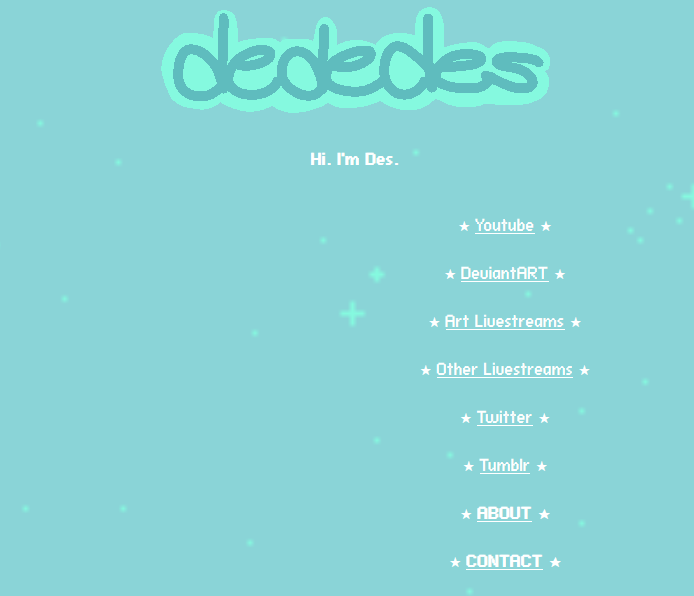
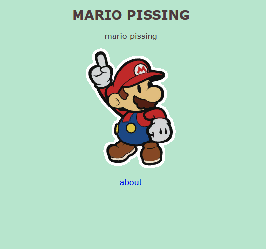
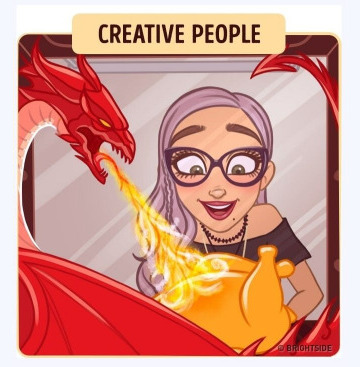

i thought it'd be fun to reflect on the site and how things are going thru this questionnaire. the original is written by [mouseling.net.](https://mouseling.net/100webmaster.txt)

1. Please introduce yourself.
	
	My name... is **Des.** My size: **big.** My intelligence: also **big. (genius)** My hobby: **Getting stuck in a room.**

2. How long have you been making websites?
				
	since 2014. i wanted to have creative control over a profile and showcase shitty OCs, among other random ideas like a kawaii-themed social network. thank god the latter never got off the ground. i hosted the former works on shady free hosts until they mysteriously vanished, and found neocities in 2016, likely through some tweet promoting it. naturally my works were a bit dry.

<figure>
	
		<figcaption>
			a website, circa 2014
		</figcaption>
</figure>

	i got additional practice through coding a HTML version of a Tumblr webcomic called "Maigo." it was Yume Nikki-inspired, heavy on pastels and moe, and set to Kikuo music. i finished recreating the first chapter before moving on.

	i alluded to this origin story in a previous version of my About page, but the first version of my neocities site was a new years letter addressed to Tip. i wrote another letter for the following year and proceeded to forget about the whole thing until i returned to coding in late 2021.

<figure>

	<figcaption>
		des.neocities.org in 2016
	</figcaption>
</figure>

3. And what got you into the hobby?

	the desire to share something unique and funny with Tip, who i badly wanted to impress. but more likely my times messing around with the Redux theme for Tumblr blogs. i still think that and its variants are the best. it kept your attention on the blog's contents while displaying detailed history of the posts, which was often ommitted from aesthetic-heavy themes.
				
4. What kind of website are you most interested in?
					
	1. creators or critics of visual arts, music, video games, books
	2. personal blogs
	3. technology focus

	i'm attracted to old games, visual novels, and DTM in particular

5. What's your workflow? Do you plan your websites out thoroughly or do you come up with the design as you go along?

	1. think of a page and what it may need that i don't already have coded, and jot it down in a list
	2. sketch layouts of the page, squares and labels in a rectangle
	3. create test imgs
	4. create HTML/CSS frankenstein monsters to test and slowly improve legibility so future me doesn't get confused.
	5. try to make useful names for elements and fail every time.
	6. make sure they work in browser and mobile viewer

6. Please link to your biggest inspirations.

	+ [Leirin](https://leirin.neocities.org) - dreamlike art and there is a great story to read in Magical Millenium
	+ [nullmi](https://nullmi.space) - super clean design, as expected of a designer
	+ [Tip](https://ectobe.ing)- she is too powerful, and helped with my site code in the past.
	+ [miela583](https://miela583.neocities.org) - she has a crazy good discipline.
	+ [KRR](http://www.kirbysrainbowresort.net/) and [TMK](https://themushroomkingdom.net) - jam-packed with niche material, though actually finding what you were looking for could be difficult haha.
			
7. What's your favourite part about making websites?
							
	watching a page slowly come to life
				
8. And the thing you struggle with the most?
				
	publishing writing... putting my jumbled thoughts to paper takes time. infact i originally began writing answers for this questionnaire a month ago but didn't make it a priority. slowly but surely, it slid to the back of the grill. i just need to FINISH before moving onto the next thing. i have to be in the right mood as well or the results are noticeably self-deprecating.
				
9. Do you keep the same layout on all of your pages? Or do you use different ones?

	mostly the same, i prefer the clarity and consistency

10. How confident are you with CSS?

	more than the past. still learning new info all the time	

11. Do you know how to correctly use &lt;dl&gt;?

	it's all over my site!

12. What is your favourite HTML element?

	the dl triple combo or nav

13. If you're making a new web page from scratch, what is the first thing you do?

	vomit my most basic idea thru .body or .section in the CSS

14. Do you know JavaScript?

	i learned enough to code a game in high school but it's lost on me now. same with Python. i could pick them up if i tried.

15. How about PHP?

	no but i'm not against learning it either. i dunno what modern uses it has tbh.

16. Does your website have a theme that you stick to?

	a plain style that's easy on the eyes. contents fall under a "fantasy scifi otaku" umbrella. gijinka comes up sometimes but i haven't published most of my stuff here... YET			

17. Are you more focused on content or design?

	the content is the meat, right? i don't focus on design much.

18. Do you own a domain name? If not, would you ever want to?

	no, and i have gone back and forth on the idea, but i think des.neocities is too well known now. if i ever change my mind, i would really like the .land suffix

19. What do you think of nostalgia-focused or "retro" websites?

	not my thing, but it feels wrong to knock people for them since nostalgia is a major reason neo and similar services exist. it's not everyone's primary reason, but certainly A reason many of us choose to hand-code sites in lieu of convenient options or paying a designer. younger kids SHOULD be encouraged to engage with coding too.

	however i mostly play retro games so i am contributing to the retroblast, a little bit.

20. Is your HTML valid? Do you even check?

	i checked once or twice in the past.

21. What are your opinion on buttons and banners?

	i love them! i would like to make an alternative, larger banner for the site. nothing wrong with 88x31 but more options are better. still have no idea who made my miku one, and i wish i could thank them personally.

22. What do you think of button walls in particular?

	i feature them proudly but it's good to space them apart in chunks to let your eyes rest. they morph into a rainbow-colored blob when there's hundreds of them smushed together.

23. If you started over again, would you make something similar or completely different?

	similar, maybe with a larger focus on my art? i never imagined myself writing as much as i do for this one. and i'm not working on large enough projects to consider separate sites for them... yet

24. Are you envious of other people's websites?

	of sites: no reason to be. it motivates me to study their code and consider new approaches.

	of webmasters: i'm a little jealous of those who dedicate themselves to a single project for many years.

25. What text editor do you use?

	Visual Studio Code

26. Why do you use that one?

	i switched to VSC from Notepad++ after working on a 11ty site and preferring the workspace and plugins. there happened to be a security scare with a NP++ installer last year but that occurred after the switch.

27. Do you host your image files on your web server, or on another host?

	on my web server, and usually compressed. i used deviantART stash as storage for old blog images, back when i had a Core membership, but the URLs were hideous and long.

28. This might not be relevant to you, but what's your opinion on the Neocities vs. Nekoweb debate?

	soooo both sites are rooted in web 1.0 nostalgia and fill the same niche. each even has a quirky cute cat mascot. what one uses is purely preference.

	neocities and its crowd skews older, and popularized returning to the "oldweb" lifestyle. think Sadgrl, Madness, Neocities Districts, all those manifestos... bold and mostly short-sighted. it's great if you want just a little bit of socializing, and user sites are established and diverse. anytime a discussion on website building pops up, neocities is almost always the first suggestion.
	
	nekoweb's crowd runs younger, and most sites i see are aesthetically bombastic but barren. it encourages customizing your website's thumbnail and update banners in addition to the site, so there's a lot of creative stylemaxxers. its premium features look well worth their cost, and the site overall has a sense of camraderie that neocities lacks. i cannot deny that it started as a legally distinct neocities though lol

29. How much server space would you estimate your main website takes up?

	100mb?

30. Do you keep local backups of your files?

	three, on my computer, external HDD, and MEGA.

31. Do you prefer simple or highly visual websites?

	simple and most importantly legible. line height and letter spacing are very underrated aspects of legibility, and too little or too much of either means i have to use the firefox reader to read some sites. please don't force my hand.

	i also can't handle light text on dark backgrounds, it makes me dizzy.

32. Do you stick to certain colours? Do you do that on purpose, or is it your subconscious?

	i use my favorite colors, sea green and coral. the site is tinted a slightly warm color for comfiness. this layout would look delightful in mustard

33. Have you ever thought about quitting? Why?

no, i just get indecisive with what to publish next

34. Do you have many webmaster friends, or is it a solitary hobby?

	dunno who considers me a friend or not but i really enjoy commenting on others' site updates.

35. Do people in your real life know about your website?

	i mention it in passing to immediate family, but i don't know if they've looked

36. Do you update your website very often? How often is "very often"?

	i don't keep a schedule for hobbies. i like to update monthly at minimum 🤔

37. And the overall design, do you change that much? Why or why not?

	no and i don't plan to for now because i'm happy with it. i would like to make new layouts for special pages, like a shrine.			

38. Is your website more you-focused, hobby-focused, or outside world-focused?
				
	majority hobby-focused with Me and World in small doses. having a diary guarantees it's about me somehow lol			

39. Do you do web design professionally?
	
	no

40. If not, would you like to? And if you're comfortable answering, what do you do for work?
	
	seems fun but not a career path i've seriously considered.

41. Do you communicate with people by email very much?

	rarely, but i welcome it. i was checking my outlook weekly until around the new year due to Microsoft 365 giving me issues. i'm sorry to anyone whose mail i missed in the past 2 months.

42. Some people reject social media and use websites as a replacement. Do you keep social media outside of your website?

	yes because it's the only way to keep up with friends and the artists i like. i'm hardly posting lately because the attention stresses me out

43. How about instant messengers? Do you use a mainstream one like Discord or Telegram? Or something like Matrix? Do you avoid them?

	i use Discord and LINE (cancelled my nitro recently)

44. Do you listen to music while you work on websites? If so, what kinds of artists?

	i have to work on my site in silence to make meaningful progress. my computer is currently an Everything Device with no shortage of distractions

45. Do you keep everything you make on one website, or do you have more than one?

	just this one and another for IRL things that i haven't uploaded yet

46. On a similar note, do you keep to one topic on your site, or many?

	many because i have many interests. master of none.

47. Do you present your real self, or at least try? Or do you construct a persona on purpose?

	i'm not sure anyone's their authentic self online, nor do many strive to be/ something's always filtered out or lost in translation, right? how i present myself here is more composed and formal than i usually am 😅

48. Have you ever made a good friend thanks to your website?

	[Hifumi <3](https://hifumeme.neocities.org) chill, helpful, and a vocal synth junkie like me

49. Are you happy with the way HTML and CSS currently work?

	no issues come to mind

50. What are practices that you think people should avoid?

	posting works in progress. if you have a WIP of any kind, you have to resist the urge to publish it for immediate gratification. sit with it for a few days and see what you need and what it needs. get into a dialogue with your work BEFORE you allow external opinions to sway you towards directions that aren't in YOUR best interests. an exception would be for if you were explicitly seeking feedback at a point where it could be factored in (not too early, not too late).

51. What about under-utilised practices, or things you think people should do more?	

	section sizes that can display on small monitors. i have a small laptop and appreciate when i don't have to zoom out to 60% to view a site.

52. Do you use a lot of semantic HTML? Or are you guilty of generic structure?

	very semantic these days, much easier to read

53. Do you consider different browsers?

	i check Firefox and Edge when working

54. Speaking of, what's your preferred browser? Convince your readers why they should use it.

	Firefox, it's no-nonsense and i like being able to access bookmarks on my phone.

55. And what OS are you on?

	Windows 10

56. Do you have a strong opinion on that, or do you just happen to use it?
				
	i was initially upset to find my previous laptop upgraded to W10 despite turning off updates, only to find it was much better than W8. looking back on it, i hated W8 and how bloated it was. i plan to dual boot on my new computer.

57. Are your websites mobile-friendly?

	sorta, but there is room for improvement.

58. What are your thoughts on autoplay?

	annoying unless it is for a project that calls for audio cues or music.

59. What are your thoughts on webrings? Are you in any?

	i check ones i'm a member of for new members. i understand those who dislike them as they are easy to break.

60. Do you have any web shrines? What do you like to see in that sort of page?

	not yet but i would like to make some.

61. Are your websites "cliche", in your opinion?

	there isn't anything special about it, which is not a bad thing! it's just not an ambitious or crazy project

62. What is your ideal website? Are you striving for that, or for something else?

	this with more galleries, logs, and homemade resources...

63. Are you an artist? Do you draw or design your own assets?

	yes it's what i do. almost all of the art on the site is mine, though not always made with the site in mind.

64. What are your favourite resource sites?

	1. [mdn](https://developer.mozilla.org/en-US/)
	2. [eggramen](https://eggramen.neocities.org)
	3. [artwork](https://artwork.neocities.org)
	4. [ballonlea.net](https://ballonlea.net)
	5. [Gifcities](https://gifcities.neocities.org)

65. Is there a habit you just can't get away from no matter how hard you try?

	writing bodies of texts in the editor. i broke the habit for this.

66. What's your biggest advice for a new webmaster?

	determine the scope of your project and possible future uses well before you start to code. you will be able to make meaningful decisions instead of stumbling around in the dark. and host your site assets on your server, better not to hotlink.

67. Do you keep all your styling in CSS? Or do you hard-code some?

	i try to keep it in CSS but get lazy and align shit in HTML

68. What do you think of frameset layouts?

	never used one. i guess they can make a page look cluttered if overdone.

69. How about table-based layouts?

	same issue as frameset and they are tricky

70. Do you subscribe to the ideas of "one-column", "two-column" and "three-column" layouts? Do you use any of these?

	it's been around forever and i don't see it going away. one column makes for easy reading on screens.

71. Do you spend longer on the HTML or the CSS?

	the HTML since i don't adjust my CSS often.

72. Have you ever made a page with no CSS? It's useful for your thoughts.

	not in a loooong time.

73. Do you ever find yourself making layouts with nothing to put on them? Or do you only make layouts when the need arises?

	i only code bases i'm sure i will use... for better or worse? it might be better to practice coding random bullshit.

74. Would you consider yourself a beginner? Or advanced? Somewhere in the middle?

	hobbyist, i have no grand goal in mind.

75. Do you have a habit of looking at the source code of websites you visit?

	i check almost every site i visit. remember whenever you're not moving i'm only getting closer

76. How did YOU learn how to make websites?

	cont. from #3, stripping down all of the CSS in redux themes. writing centered Carrd-like profile pages. repeat...

77. Do you ever force elements to do things they're not supposed to?

	making baby sections in sections? is that allowed

78. Thoughts on floating elements?

	confusing!

79. When you're sizing stuff, what do you use first? Do you use px, em, %, or something else?

	usually px but sometimes mess with % and em.  mostly by vibes. one of those things i could improve on.

80. Do you have a favourite font?

	Helvetica, Comet (FontWorks), Merriweather, many others

81. Would you run a website with another person? How would that work?

	would depend on my role. i wouldn't want a collaborator waiting on me for random things

82. Do you surf the Web to find new personal websites very often?

	often, only on my computer. i like rereading my friends' blogs too.

83. Do you bookmark other people's websites? How would you feel knowing someone else bookmarked yours?

	i check the neocities feed daily so i don't feel the need to bookmark. i'd be flattered if anyone bookmarked mine.

84. What do you want people to be most impressed with when they see your website?

	the neatness? the cute special banners i make for certain pages... or even... my incredible artistic mind?
					
<figure>
	
		<figcaption>
			picture of me
		</figcaption>
</figure>

85. Are you interested in technology outside of websites? Do you collect?

	computer building/repair and console modding, on casual levels. i keep small CD and DVD collections. bandcamp comes in clutch with how expensive importing currently is.

86. How often and for how long are you online?

	how about we stop talking for a little while

87. When it comes to your website, who is your target audience?

	i guess fellow adult otaku to game, jam to music, and draw pictures with. and any gijinka/delusional fans!

88. Have you ever been interested in XHTML?

	no, never read anything on it

89. Do you program in general? Have you ever written a program for use with or on your website, not counting simple JavaScript?

	noooot really. again, i could, just not a priority right now.

90. Speaking of programs that help you make websites, what do you think of static site generators (SSGs)? Have you ever used one?
				
	they are pretty cool and i've worked on a 11ty site before. just as easy as HTML. i could potentially rework this site into ssg...

91. Do you keep a hitcounter? Why or why not?

	no, us insecure fools incorrectly correlate them with our worth. i briefly used one for my old Tumblr blog but realized it was creepy.

92. Do you frequent forums? Which ones?

	i read GameFAQ, MyAnimeList, and ps2-home on occasion

93. Do you write your page content directly into the editor, or do you prepare it elsewhere, like a text document or a Word document?

	cont. from #65, the former was my bad habit. i switched to writing drafts in Zim with the Rei zine blog post.

94. Do you think you appear cool to others? A more accurate answer now: do other people ever say you're cool?

	maybe because of my art but as a person no.
				
95. Are you embarrassed of your old work? Have you ever deleted everything out of shame?

	very much so. i don't like thinking about my quirk chungus behavior from high school and prior. but i also can't be assed to remake social media accounts constantly, not anymore. that was so common in my twitter cohort.

	nowadays i keep in mind that others don't have the reservations i do for my own work and it would be selfish to take it away from them. for example, i still get nice feedback on my old Cookie Run and Star Allies-era art, nuking that would be cruel.

96. Would you close down your website if you couldn't update it, or would you leave an archive?

	preferably archive. i could only see a 50y/o me taking it all down if she worried it was too incriminating or something.

97. Do you reveal a lot about yourself on your website? Or are you more secretive?
				
	i'm lowkey mysterious and nonchalant and stuff (no idea)

98. Are you willing to reveal who your best online friend is, and/or if they have a website?

	[i've written her name enough times in this shitty blog.](https://ectobe.ing) wish more of my besties would make sites.

99. And do you optimise the images on your website?

	most but not all. my friend Sako introduced me to a [web image compressor](https://squoosh.app) that i haven't fully adopted yet, it might come in handy.

100. We're out of time! How do you feel after answering 100 questions? ....other than exhausted.

	hope whoever made it to the end enjoyed it and maybe even took something away from it... ^-^