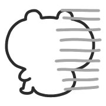

Welcome to Version Three!... what do you mean there's hardly a difference? I spent 3 months keeping it a secret for noble reasons. Guh.

The site has been converted to **11ty** to improve workflow and prepare for site growth. It's not perfect under the hood, but I enjoyed learning it. Some much-needed changes have been made to launch alongside this update.

### New

* A new RSS feed, linked in the footer, that will push updates from this point on. They will be used for anything that involves a page update of some kind: blog, library, cd. That's the plan anyhow.
* Light and dark themes that match your device or app preferences. The dark theme is " midnight melon," for now. Thank you to [Miko](https://mikos-mishaps.neocities.org) for the help.
* New index that merges the About page with it, with new art of Manila and Des (my Inkling, since I don't have a formal persona).
* Page name changes. "Works" is now "Garage," and "Changelog" is now "Updates."
* New page in the Garage: "My Computer." Originally a blog post about my PC building experience that I thought would fit there
* 3 new CDs in the Library CDs page
* Site credits have been moved to "Updates"
* Slight section size increase
* "Dream C Club" page moved from Garage to Library
* Temporary removal of "Fun Stuff" in Library, thinking of moving some of the links in there around
* Logged into my email on my phone so I actually see incoming mail; don't hesitate to mail me again if I missed you.

### Upcoming:

* The gallery, the most ambitious addition to the site, is next. It will be generated by the state-of-the-art Canadian AI model, TipGPT. It will take a long time to get what I want archived, but it will be fun.
    * The free coloring pages will be moved here.
* Pages for other fan characters like the Kirby gijinkas. This'll also be a long-term project, as I get lazy with writing. I would like a ghetto wiki here.
* "Fun Stuff" reorganization
* Writing on more niche subjects. "Behind the scenes" blogs are my favorite to write – they are educational and I like to think they could inspire a reader – so those will continue, alongside the occasional review.
* More site-unique art for headers and the Updates page, a second button design

I am open to feedback. Feel free to send mail, write on the Guestbook, or message me elsewhere.