### 12/25/2025

Merry Christmas!

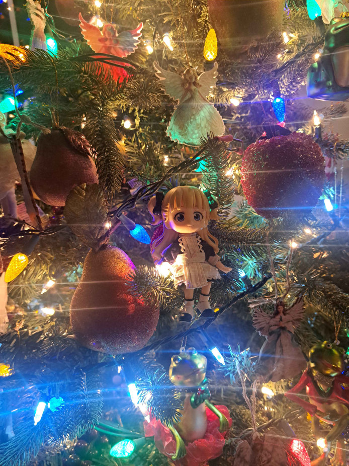

it's not Manlia's Gifts (last year's lil Christmas event) but jolly Emilico and my TF drawing should suffice

### 12/18/2025

i jinxed it and embarrassed myself at work today. SDHNFIOASDFSBD!!! funny, but mostly embarrassing. i stopped at the store next door afterwards and found a lone Funko Pop Cyclonus. it was as if my guardian angel had come to comfort me. i got him for $5. my first funko pop. he looks hollow

many people complimented my hair today ^-^ usually i mindlessly blowdry it and find one side wavier than the other, but last night i dried it evenly and lightly curled the front bits

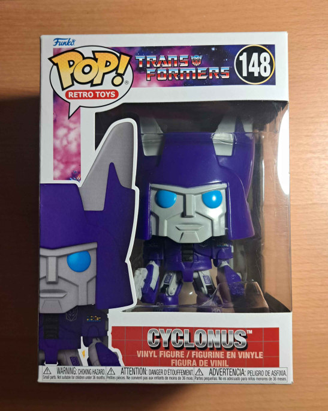 

### 12/17/2025

i'm scrambling for the drive to create this month. the cold got to me fast this year and we aren't even at the solstice yet.

i was expecting much worse from holiday shoppers, but everyone i've helped has been friendly and polite. tiring of course but not having skeleton crews has made the shifts fly by

in early november i returned to my GCN animal crossing save-third time's the charm-and have played thru every in-game day of the winter. with 2 villagers and conscious efforts to progress, i'm almost to perfect town rating, collected all winter camper items, and missing one dinosaur fossil, the plesio neck.

been watching magic knight rayearth 2 with my friend, but somehow almost nothing has happened in 8 episodes.. FUUUUUUU!!

### 12/1/2025

finished working on a big piece for an Adachi Rei zine. It's my first comic (11p+cover) so it's not amazing but the first step in a direction i've been hesitant to try for years! for that alone i'm proud of it and will share more when i'm able.

i made roasted brussel sprouts and snickerdoodles (transrats' recipe, though they didn't turn out so pretty) for Thanksgiving but nobody ate them. came after everyone already ate, so... i gave some to my neighbors

### 11/26/2025

picked up a used MSI GTX 1660 Super and some DDR3 RAM sticks. although i need DDR4. beginning of the PC era. my laptop's coming up on 6 years and i'm due for an actual PC.

### 11/1/2025

movies i watched this week:

+ Mr. Nobody: like watching all of the routes of an adventure game, almost too much like it with their extreme, often comedic, consequences. one route hoards much more screentime than the others which could lead the viewer to believe it's more real or true, but nemo lived all of them. that said i enjoyed the nonlinear presentation, it's super engaging.
+ Jurassic World Rebirth: scarlett in response to a giant 500 ft long eel thing that visibly wiggled past them: did you guys hear that? dora the explorer-tier script, annoying score that DEMANDS you feel X emotion for X scene, and dumb goals to motivate the plot.
+ Aliens: more action Rambo thriller than the og but a perfect followup, with a a scathing disdain for corporate and military exploitation. i felt sorry for the xeno queen who hurt so badly for revenge that she left her eggs.
+ EMESIS BLUE: fantastic camera work and heavy-handed on the noir visuals. spy's transformation into becoming who he hates is perfect, and it really shines at its climax

### 10/28/2025

(writing this well after the fact) i turned 25 today! had dinner at my favorite restaurant and family surprised me with crumbl, a Golion art print, and a MG RX-78 II. i also got the Emilico Nendoll from Tip and drawings from my friends.

### 10/15/2025

finished a still life i started when i was in canada. i had a perfect photo of the scene to complete it but i would not advise painting that way ha. our eyes get too caught up in the details/colors are different/space is flattened/missing spontaneity/etc.

### 10/5/2025

had lunch with my family today. my uncle kindly paid for it!

completed AIR the other day. so much i could write about it, so i'll hold off doing so here. i love the heroines' blushing sprites though. when lined up like this, i noticed their features are slightly slanted. a classic Artist Thing.

planning to read the murder of sonic this week, then return to anne of avonlea. tip gave me a copy when i was at her house, but i set it aside for AIR.

### 9/27/2025

photogenic crossworlds

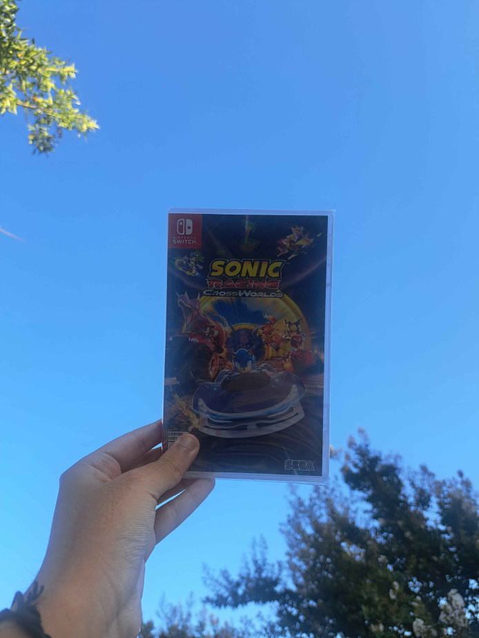

### 9/23/2025

i finished the [mario's picross piece](https://www.deviantart.com/dededes/art/Mario-s-Picross-40th-Collab-1245171974) and am content with it. it's not very interesting or derivative, but it was fun to draw freehand on a grid. other than that my motivation dipped again, think i'm just feeling aimless rn. the silver lining here is that i revisited an idea for a fan music video... a longer project might be on the table. had an idea for a small "fine art" series too. and photocards. and finishing a still life. and. and. this is my problem... being a stupid idea guy

### 9/18/2025

last night's show was jpegmafia and linkin park. pretty good show and i was pleased with the sound! i think medium-large sized indoor venues are better for a fuller range of sound/sound travel, but i wonder if others prefer outdoor. maybe this is all placebo. i'm not well read on this topic

the US presidency has been so embarrassing so far. it's distressing and i feel for young ppl and immigrants affected by all this crazy shit.

### 9/16/2025

my motivation walked off a cliff last week but i'm catching up with things now. played PEAK with friends. i should have told my friend to die so the other friend wouldn't be chased by the scoutmaster -.-

to get myself to draw, i'm working on my piece for a Mario 40th anniversary collab. JP Mario's Picross of course!

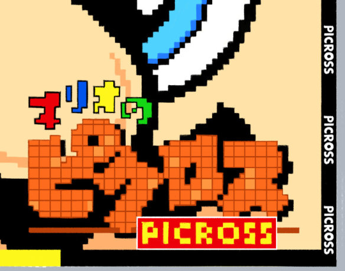

also Kamitsubaki has Meta in it now. doesn't improve much.

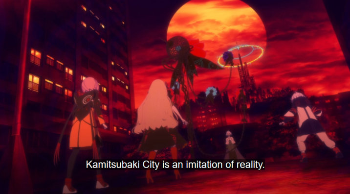
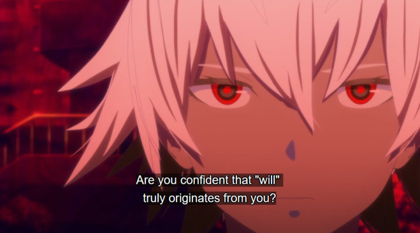
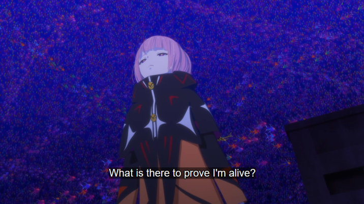

### 9/7/2025

saw Everclear last night, great show as usual :D apparently we've been to all of their shows at August Hall. light guys needed to chill though, they were really intense this time.

topcoated GM, caught up with transformers cyberworld, and am onto the Summer chapter of AIR. misuzu's autism is never a burden. she is my friend

### 9/4/2025

lately i've daydreamed of making photocards and postcards as they're realistic to ship within the tariff and de minimis nonsense. i LOVE postcards and have photocards by Duo Mustache on my desk right now haha. so i don't forget i'm going to list tools i could use to make them at home

+ cardstock/matte paper thin enough for a self-service printer
+ printer needs borderless support
+ 1/2" & 1/4" round corner punch
+ paper trimmer
+ holo cold laminate sheets
+ laminate machine with hot/cold option
+ art: +.125"/3mm bg border
+ print template: add crop marks

i also finished lining and re-assembling my GM kit, he is really cute! simpler and a little more brittle than the 2021 zaku. i'll topcoat them tomorrow

### 9/2/2025

new panty and stocking is good, kamitsubaki is still bad and in fact getting worse

### 8/30/2025

played sonic crossworlds with my friends and i was really impressed, but it's too much for me today. (going on 3 hours of sleep) the sonic ring sound effect is so annoying...

rin and len NT's designs are crazy, but the demo, short as it is... meh

### 8/29/2025

i planned to take the train to a con today but they sold out of tickets for the return trip. shoulda booked earlier in the week, but it's no skin off my teeth.

with the day freed up, i was able to finish my [Miku birthday art piece.](https://www.deviantart.com/dededes/art/Yellow-1236188717) i drew it at 8.5" x 11" like a magazine page but i doubt it'd print well with it being predominantly blue.

i also finished minagi's route and what an ending, stunning CGs and interesting story, even if it dragged at times. if all routes were to be canon, minagi's would make for a great segway into misuzu's, with its larger clues towards the winged girl and yukito's decision to part with minagi. the anime is organized that way but the breakneck pacing means nothing really gets to sink in

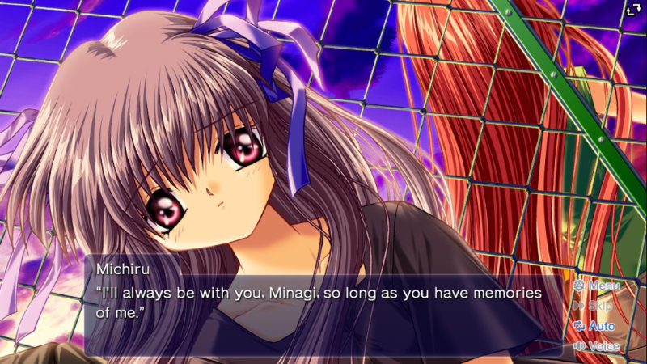
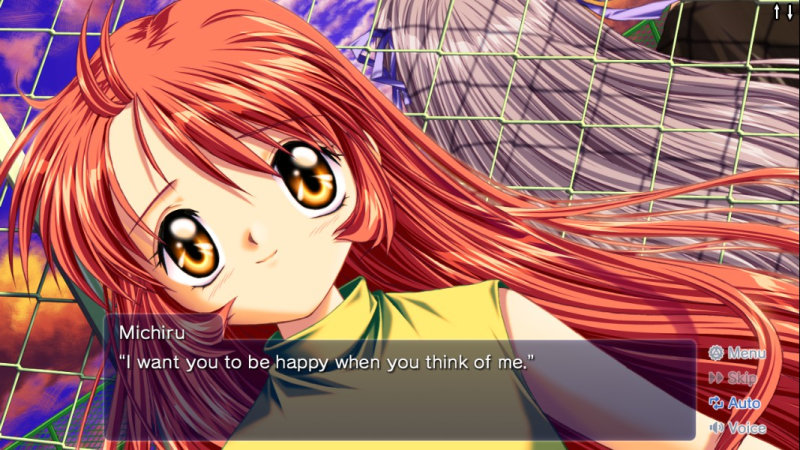

### 8/19/2025

Every time I find I'm blocked by someone on Twitter, it's a Kirby fan. And I understand because I was a menace during the Star Allies update days and my art was weird/not good. But I promise I'm not like my 18 y/o self now.

I'm very pleased with what I saw in the Air Riders demonstration. Sakurai Dedede and Kirby are their best designs

### 8/17/2025

Unsure if one of my managers can't stand me or if they just make me self-conscious.

### 8/16/2025

Stopped at Cakehoarder Games' grand opening after work. It was an hour-long wait to check out, but the crowd was patient and relaxed. Cool to meet the cum man/the guy who helped preserve Pickles.

Pickles... Santa Cruz Games... i used to obsessively replay Dora the Explorer: Barnyard Buddies...

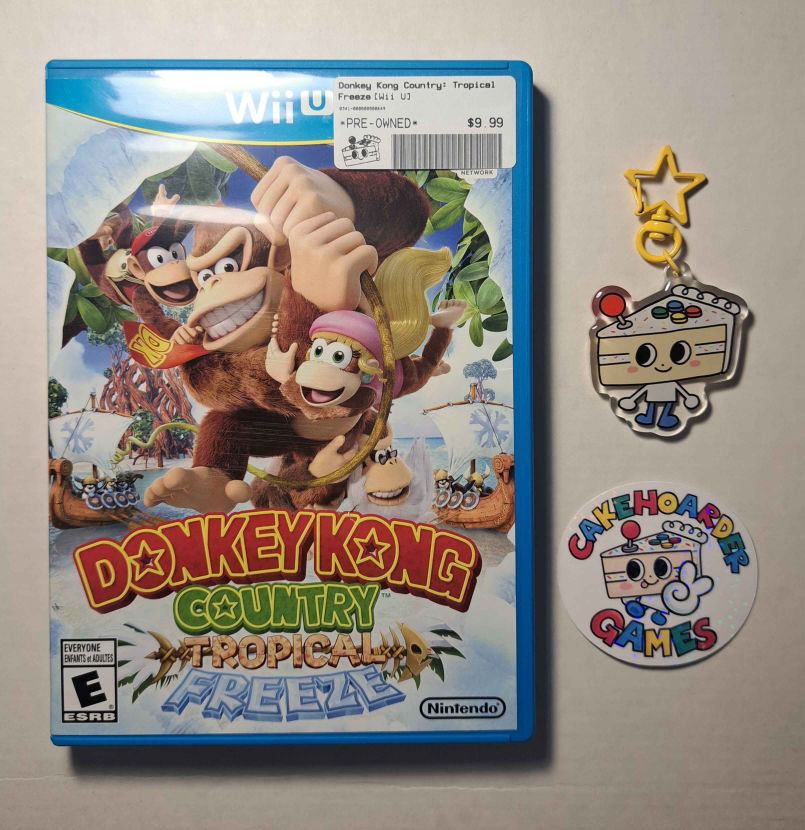

### 8/15/2025

Completed Kano's route and avoided a bad end. The buildup to Kano's strange condition and how it breaks up an otherwise static day-to-day life is similar to Mai of Kanon. They're both suspenseful only to suddenly sideswipe the reader in the climax. Unfortunately, to me, Hijiri outshone Kano in most ways.

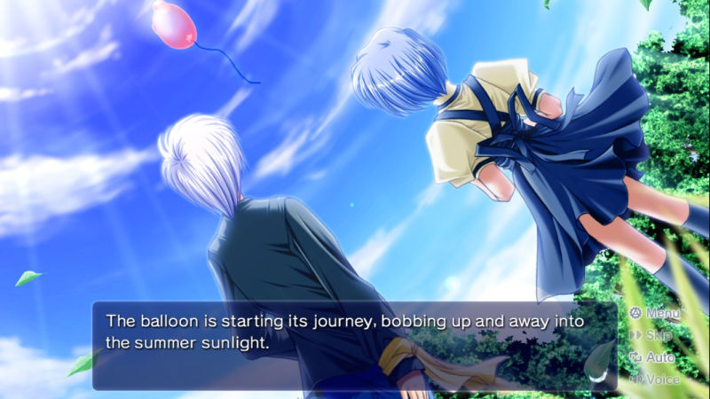
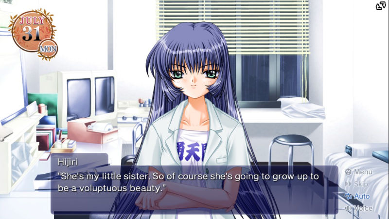

### 8/11/2025

trying to draw a lot of things today and not getting anywhere. that happens with my scrambled mind. Kamitsubaki is still bad. what's worse is that i CRAVE bad.

### 8/10/2025

started watching Kamitsubaki City - Under Construction

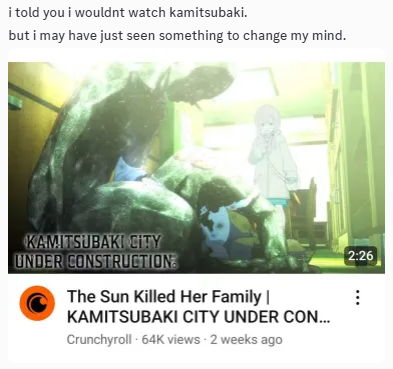
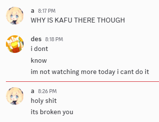

### 8/8/2025

found a photo of my 2013 game rig. i didn't have much at this time.

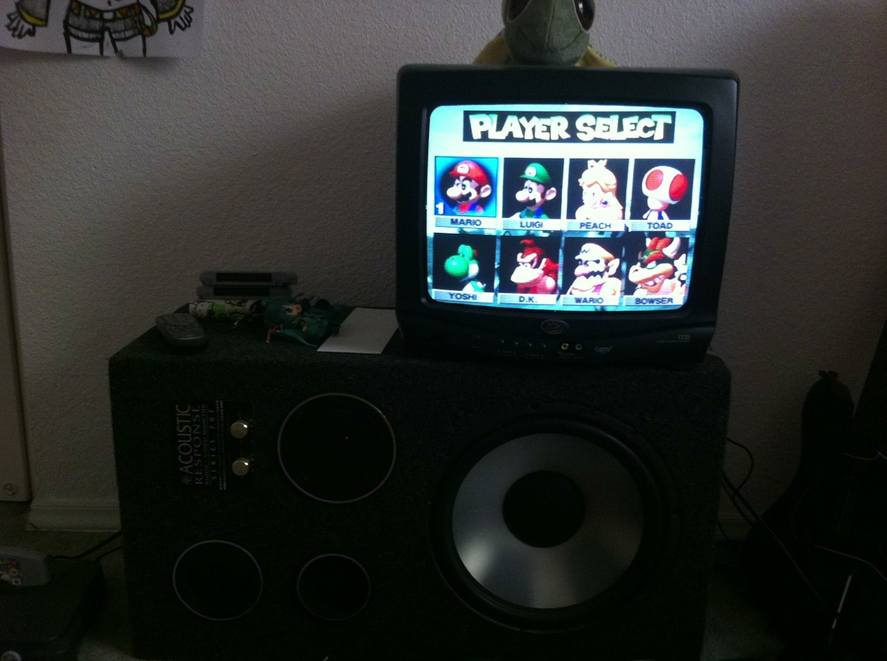

### 8/1/2025

My dad framed a Splatoon 3 poster for me and I hung it up today. I've had it since the game released and it's so nice to finally have it up. We have frames for paintings from his old workplace, and most Gamestop posters happen to be the same width (24").

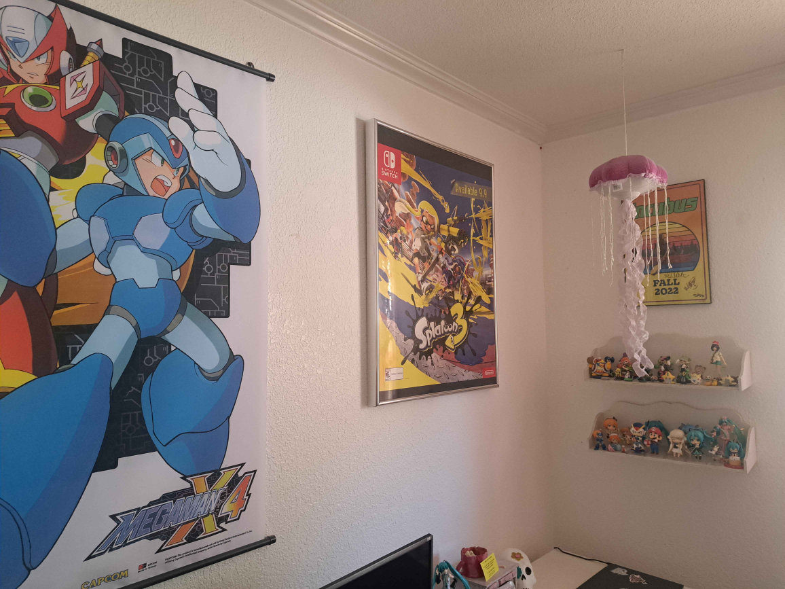

### 7/31/2025

Comics ^-^ The Transformers issue is for display as I'm already caught up. X Timelines plays a safe start with good art. There's an announcement for a X comic series at the end, and maybe I'm getting ahead of myself, but I'd love to see an original plot that shakes things up a bit. Mega Man games are difficult to adapt chronologically because most subseries have so many entries. Imagine a leap of faith.

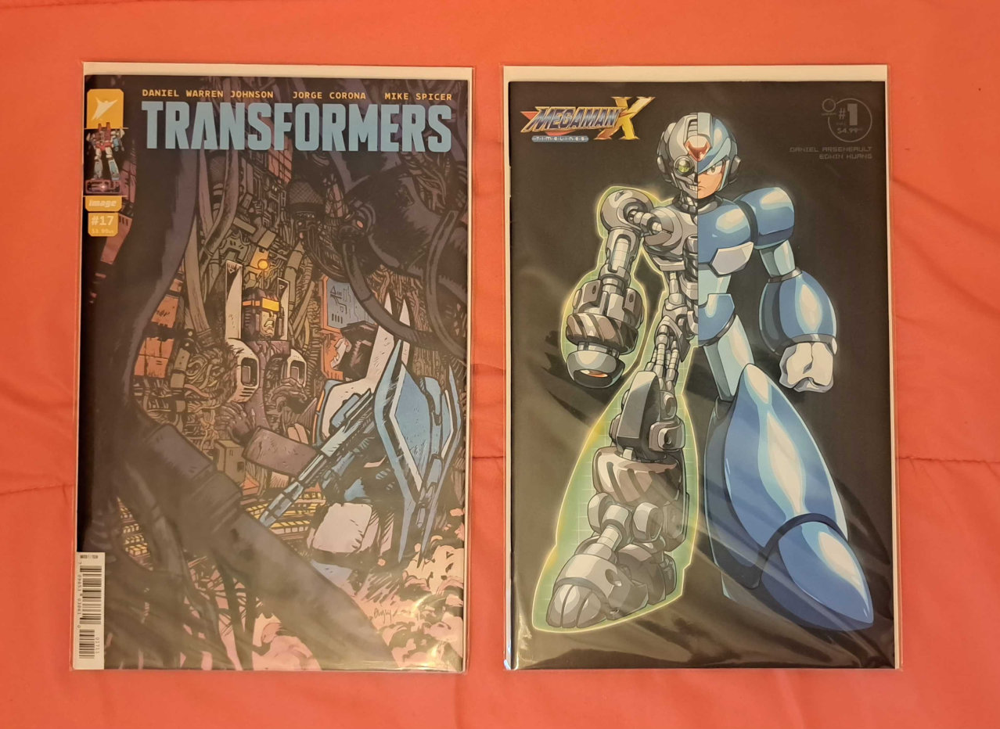

### 7/28/2025

I finally completed a commission I was slaving over for weeks so I've tended to the site a bit.

### 7/17/2025

the 1025th summer is upon us (i bought AIR during the Steam Summer Sale)

### 6/15/2025

June's been busy, lots of errands and trips. This week, I visited the beach and zoo, and found new eats during the former trip. The zoo's undergone some much-needed renovations (visually and for the animals' comforts) and was a great albeit brief experience. Now I'm gearing up for vacation. (Wasn't what I just described basically a vacation...?)

I've since completed all of the art mentioned in the previous entry. I'm slowly chipping at a Splatoon commission, just took a while to remember Inkling proportions, even with all of my personal notes. Nothing alarming, just out of my element. And we started on that collab piece. ^-^ (I still owe him a clay figure of The Lost...)

One more thing. The site hit 100K views!!! I'm going to commemorate it doing what I do best, but it will take time. Something I haven't done since I was a kid.

### 6/12/2025

Messing around in Splatoon 3 before gathering references.

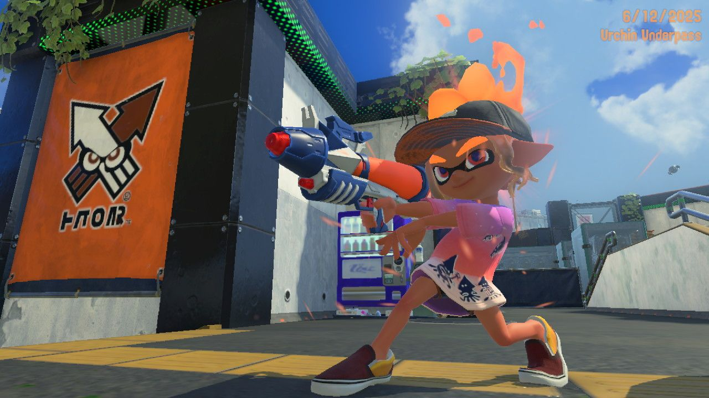
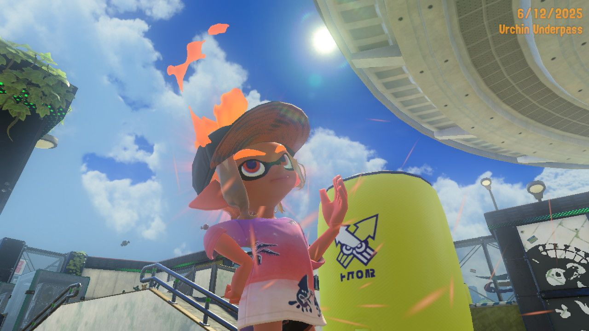

I love the smiley stickers on the Gleamz, very me.

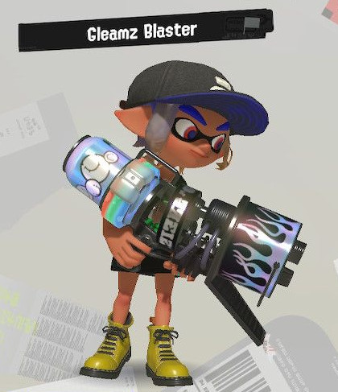

### 5/16/2025

Finished my still life last week and awaiting judgement. I think I used too much white when mixing colors throughout and it caused muddy contrast issues in some spots, but overall I am fine with it. To painters reading this, don't make that mistake.

Finished reading Stella of the End last night and it kinda mogs planetarian and Harmonia. Somewhat tropey and some scenes drag on well after their impact but the package is amazing. I went back to screenshot most of the backgrounds for reference.

I'm back to reading Shadows House after putting it down for a few months-my favorite manga all right-but I'm working on a few [fanarts](../images/my-art/shadows-house/emikate2.png) for it on and off. Juggling that and the Splatoon still life, then I'll return to commissions for a bit. My brother has been in low spirits about making art so I'm thinking of springing a collab idea I've had on him.

(musing) When it comes to art, I like to think I'm extremely self-motivated, but pretty selfish, and love creating for myself. (Disclaimer: everyone should create some things for themselves) Gijinka, for example, is peak self-indulgence, but that makes them a bit unapproachable... I still want to develop series that resonate with diverse audiences, like Pro Memoria. I'm factoring that attitude into my future abstract works to make a little adventure viewed through paintings. That's the current idea. And I could put more effort into making gijinka approachable lol but I get stage fright imagining attention from fandoms lately. Like, "I'm sorry I'm doing this to your favorite character..." It's a silly feeling that I'll overcome soon.

### 4/11/2025

There's a lot on my mind lately and it's impacting my productivity. Between the site, learning my job, family, digital and traditional arts, selling old stuff, planning when to travel, and the Super Sculpey block on my floor... ... I need to straighten out my priorities...

I spoke at the gallery last night, but I forgot half of what I wanted to say. I recited all week and still buckled under the pressure. T_T But I hung around and chatted long after it was over. That was much more natural and enjoyable.

On the topic of traditional art, I plan to paint one still life for an upcoming show and another for Splatoon's 10th anniversary in May. I've been sitting on the idea for months and it's finally time to commit.

As for the site, my friend suggested I add early concepts of the GKBs... that's likely next.

### 3/19/2025

A lot's gone down in the past month, good and bad:

Bad: I lost my dear Max on the 23rd :,) He was on a slow decline and his long-term prognosis suddenly dipped. I get a little misty thinking about him and how he'd always sit with me when working on projects in my room, but no point in dwelling on what could've been. He had a good time! One of my favorite photos of him is on my PS2 modding page.

Good 1:The risk in discussing this here is very low, so... I found a cashier gig. We'll be setting up merchandise at a new location soon and I'll probably be at the grand opening... exciting?! That energy will fizzle out but saving money and being able to help pay bills is motivating in itself.

Good 2: My VGen is ready to go :D I'm digging the platform, covers almost everything a creator needs. Throws you to the wolves when it comes to writing a Terms of Service or pricing though.

Games: Cycling through L4D2, M&L Brothership, Stella of the End, and The Binding of Isaac. I caught a 2v2 Tower Control challenge in Splatoon with a friend yesterday.

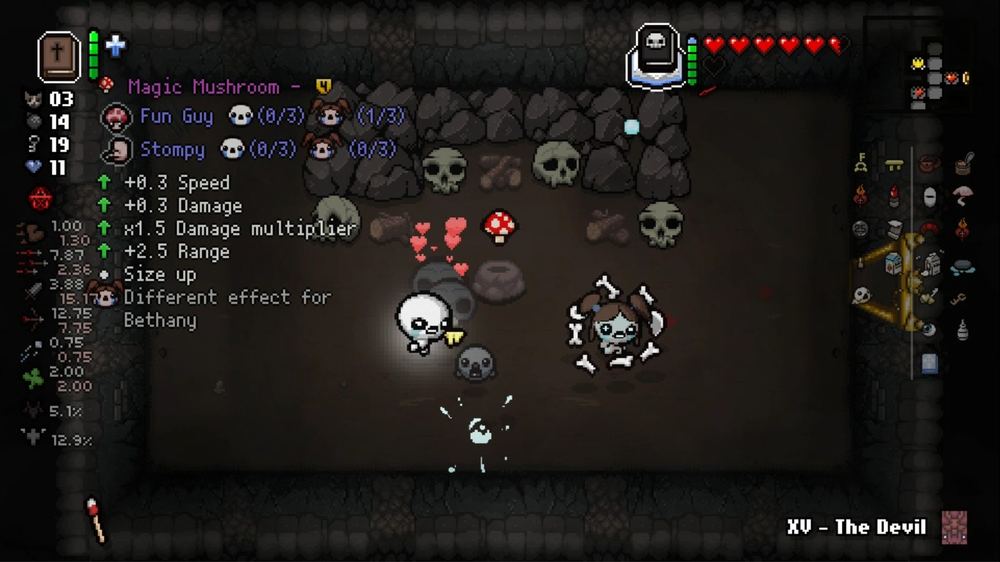
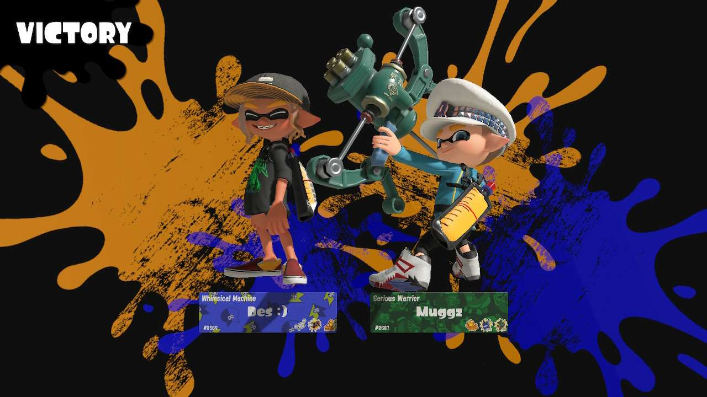

### 2/07/2025

After painting a ton of new works from late November to Feb 1, I'm taking a nice long break... just kidding I'm back to painting and job hunting. I want to feel like I'm earning my own money for long-term goals: travel, a PC, donating to causes and businesses. I also have VGen...

Went to my painting professor/mentor's reception last night, turnout was huge. Got to catch up with some faculty and friends too yay. She's trained in curvilinear perspective and seems to plot her comps so effortlessly. Same goes for her applications of washy and opaque strokes. Taking notes.

And I set up a new build of OPL to play Ape Escape: Million Monkeys (there is now an English patch) with my brother; he played Team Spike's story and I'm doing Team Specter. I think there's a mismatch with my OPL config files so they keep resetting on startup, but I'm too into the game to fix it. Anyway I'm feeling mixed on it... the scenario attempts to clear up the poorly explained villain of Pumped & Primed, but he's too plainly evil for it to matter. An abusive mad scientist murdered by one of his creations (lol). The visual aesthetic clash seems self-aware but very confused, like it can't decide whether it's comedic or dead serious. At least the comedy's solid when it leans into it? The gameplay is very fun with its weapon switching/juggling/stamina balance, but the later story stages and tournament mode suffer from repetitive objectives. Why a single tournament stage? P&P had at least 8...ehh, I think most of these issues were time constraints. P&P was definitely 'weird' for a spinoff but balanced and foreshadowed its twists. I understand why the [Saruge Archive guy](https://x.com/sarugearchive) dislikes MM. 