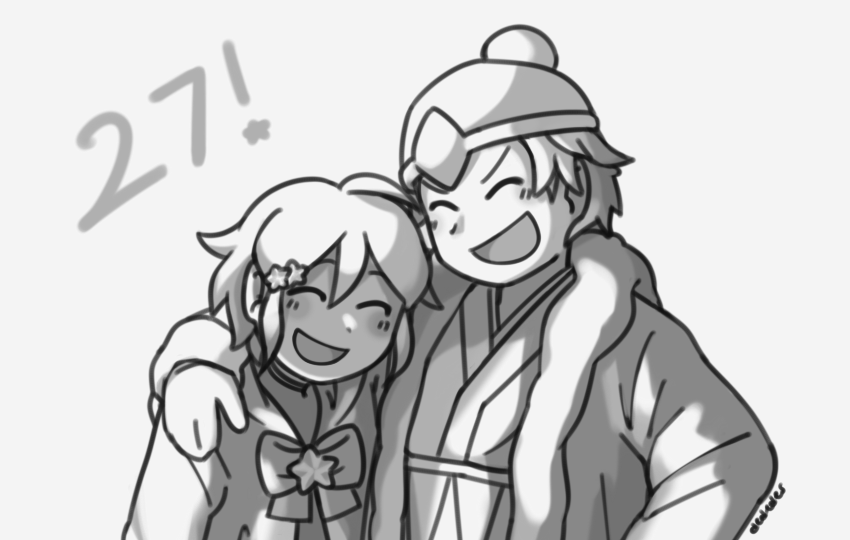
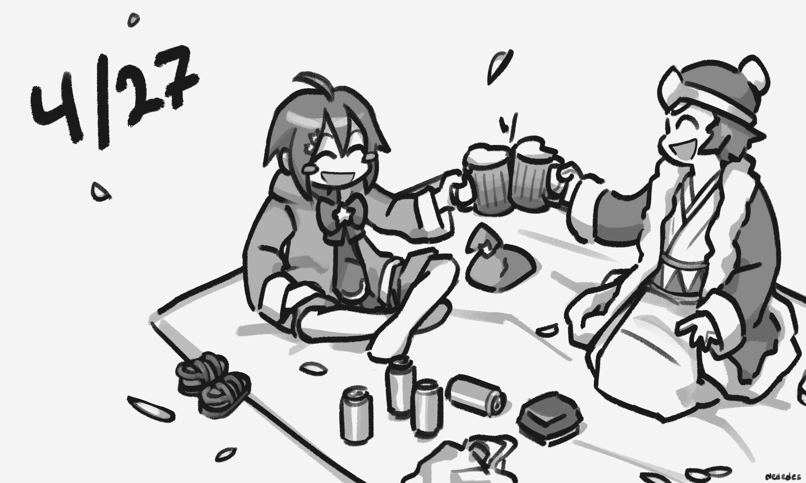
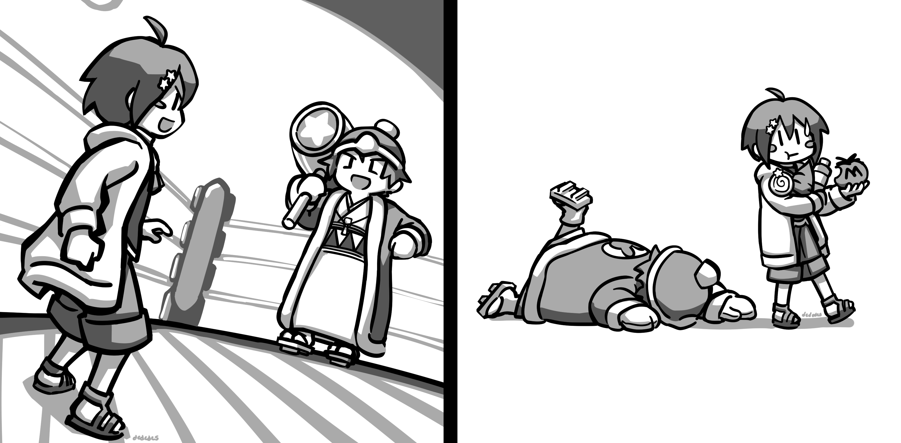
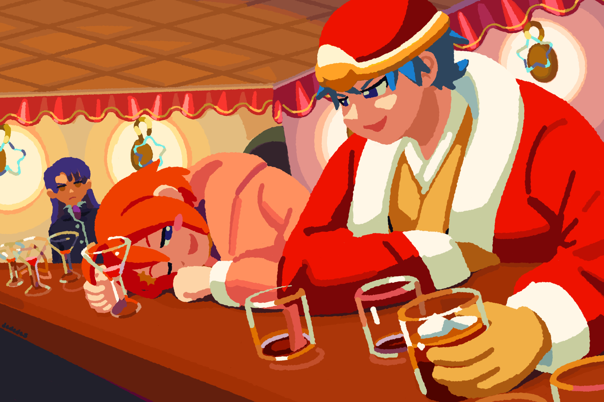
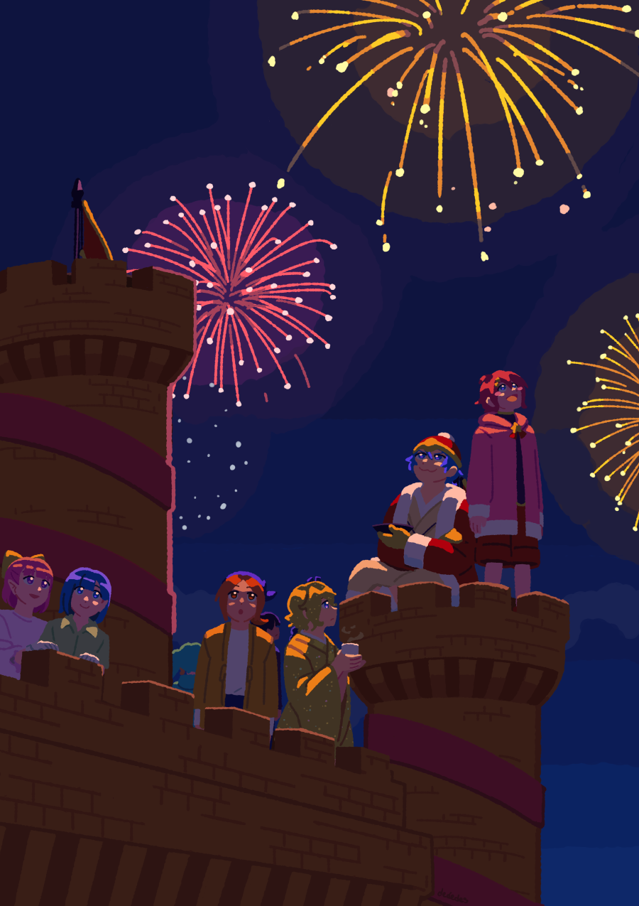

## Kirby Anniversary Art

Since 2018 I've drawn something Kirby Gijinka-related to ring in the new year (last updated 9/9/2025).

### 2019

Happy.

### 2020

Drinking beer and viewing off-screen cherry blossom trees. They brought their glasses and everything, so it must be a regular occasion.

### 2022

Kirby and Dedede in a Kirby's Dream Land throwback, and the aftermath.

### 2024

 In the castle bar with a surprise appearance from Meta. This piece was completed 3 months after the date, but's in the spirit of the anniversary.

I inquired a friend about specific drinks they might like and she suggested daiquiris and rum and coke.

### 2025

 It's a fireworks show at Castle Dedede. A relaxing scene with some guest appearances. I wanted to include someone I never draw, so Lolo and Lala, the duo on the far left, joined in.

Lolo and Lala are castle servants in this setting so it made sense for employees to have quick access to the castle balcony.