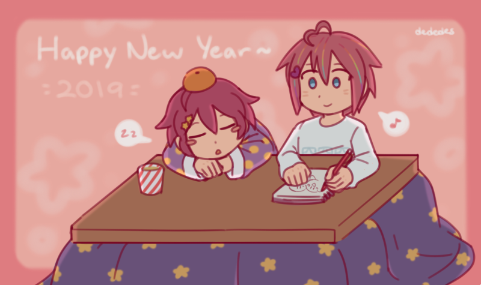
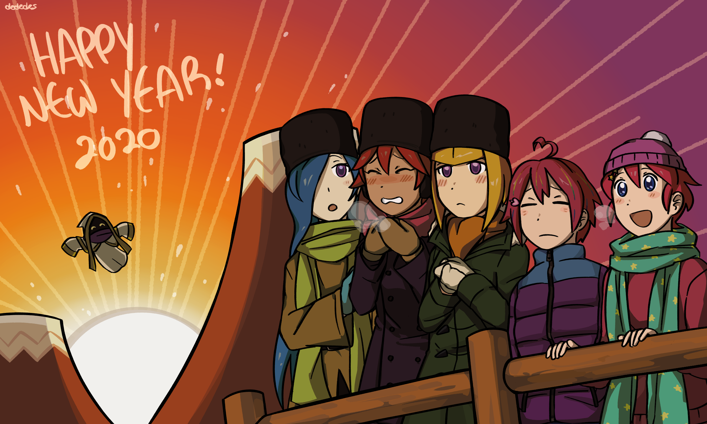
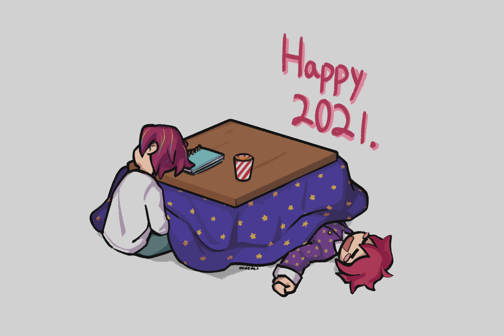
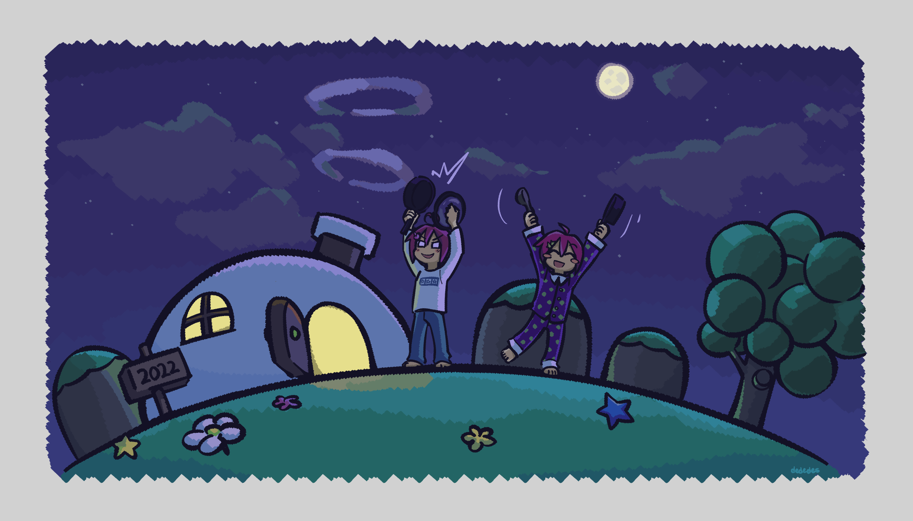
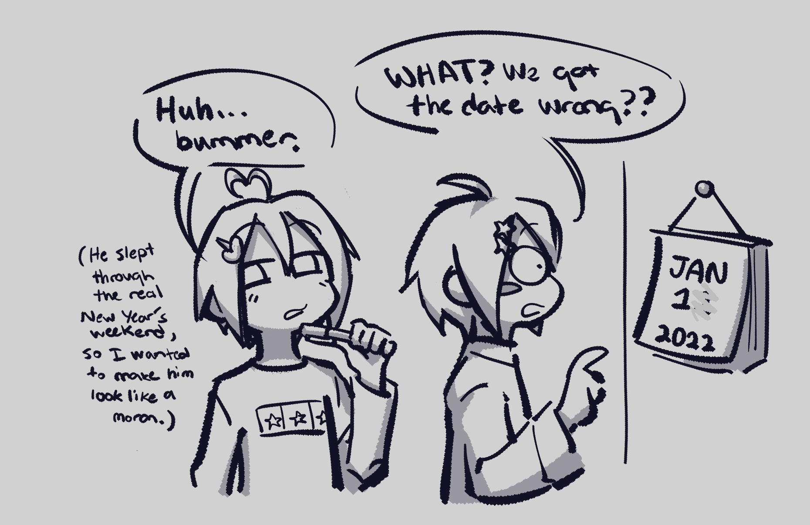
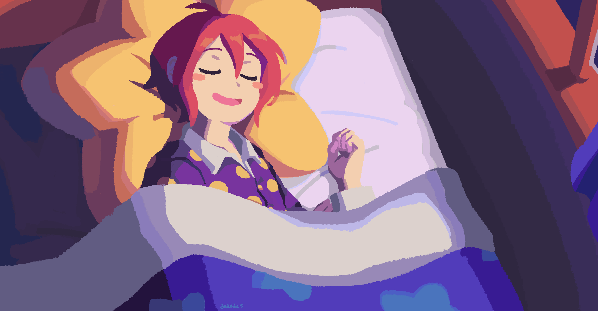

## New Year Art

Since 2018 I've drawn something Kirby Gijinka-related to ring in the new year (last updated 9/9/2025).

### 2019

Kirby and Void Termina. Void was mild-mannered back then.

### 2020

Kirby, Void Termina, the Three Mage-Sisters, and Hyness. It references this Kirby Twitter commemorative art for 2018.

### 2021

Kirby and Void Termina who fell asleep before midnight.

### 2022

Kirby and Void Termina banging pots and pans 10 days late. I used to do that as a child, on time of course. I struggled to finish the drawing in time so I made a joke out of it.

### 2023

Kirby sleeping like a baby.

### 2025

The main 6, with Kirby being his usual terrible self. Not themed like the others but it fulfills its role as 1. a GKB drawing and 2. first art of the year.

Lightly inspired by [this Ape Escape P&P wallpaper.](../../images/gkb/Ape_Escape_Pumped_&_Primed_Wallpaper_9.png)