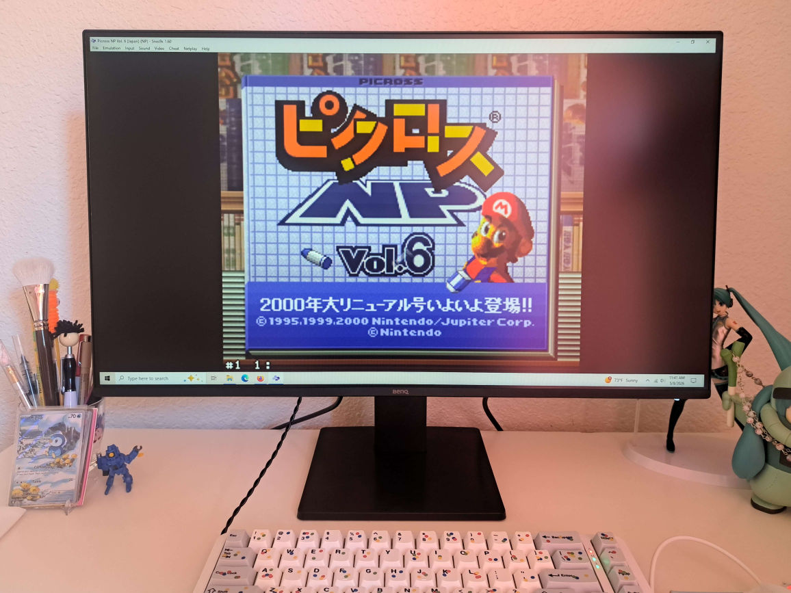
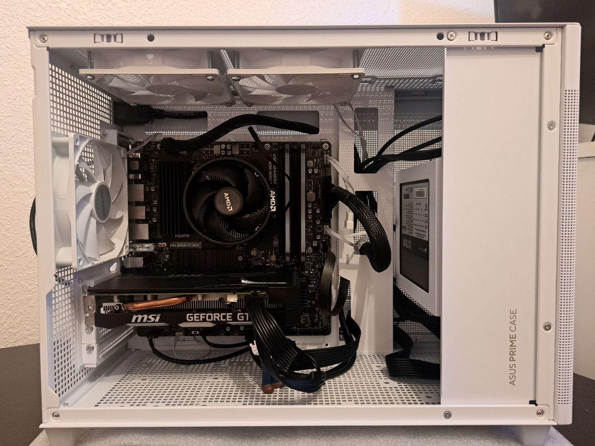
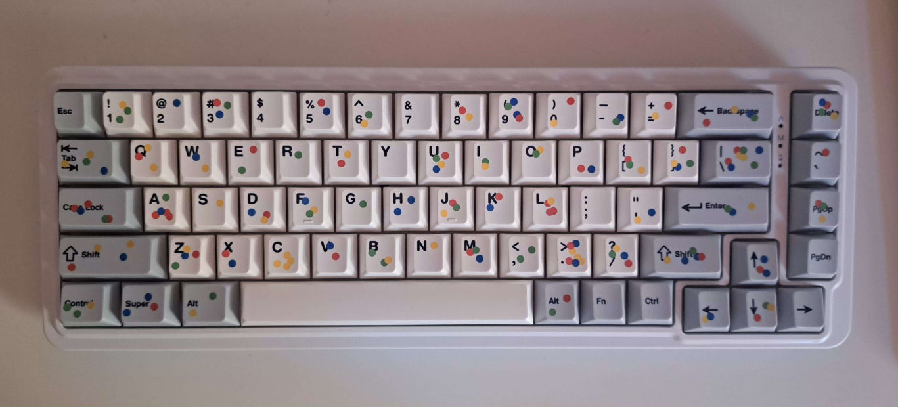
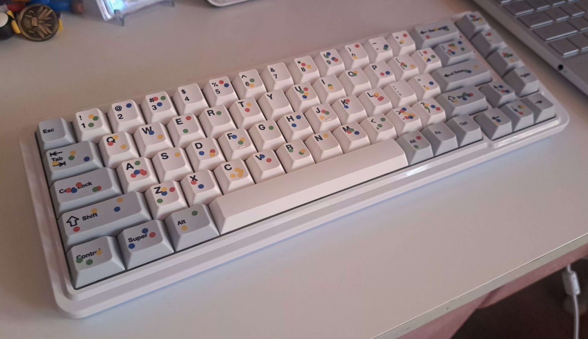

## My Computer

+ Gathered from 11/2025 to 4/2026
+ Built on 4/27/2026
+ Began life on 5/6/2026

### Parts

+ **Motherboard: MSI PRO B550M-VC WIFI Micro ATX AM4**
    + Cost: $97.98 / Newegg
    + It is a motherboard. The quick start manual is useless, had to use the full manual available online. BIOS is easy to get around.
+ **CPU: AMD Ryzen 5 5600x**
    + Cost: $145 / eBay
    + Gunned for a 5600 but figured the x's superior performance was worth the extra $20. Found like-new with the stock cooler on eBay, seller was great. Currently using the stock cooler; I might switch it out later.
+ **GPU: MSI VENTUS XS OC GeForce GTX 1660**
    + Cost: $85 / Marketplace
    + Found used locally, and it ran great according to the benchmark I requested. Old card but does exactly what I want it to. Potential bottlenecking with the CPU, but I haven't tried anything intensive enough to confirm.
    + The GPU stand I picked up was too tall for it, so i have a Luigi figure doing the job for now.
+ **RAM: Corsair Vengeance RGB Pro 16GB (32GB)**
    + Cost: $80 / Marketplace
    + Found for a steal locally. I put the other half aside for now. I've come to enjoy the diffused rainbow lights from the mesh case.
+ **Storage: Crucial P310 1TB**
    + Cost: $106.99 / Best Buy
    + Absolute cheapest SSD I could find after weeks of stalking listings. Not the 2TB I wanted but more than enough, speedy and solid.
+ **Power Supply: Corsair CX750M (2021)**
    + Cost: $59.99 / Newegg
    + Cheapo power supply on a discount from Newegg. It is a large, scary, but modular box.
+ **Fans: Thermalright TL-C12CW (3 x 120mm)**
    + Cost: $20.07 / Amazon
    + Purchased 3 but ended up using 2. The included screws were useless - I have no idea how they'd attach to any case, let alone mine - so Dad and I jerryrigged a solution with nuts and bolts.
+ **Case: Asus Prime AP201 MicroATX**
    + Cost: $84.99 / Newegg
    + Christmas gift from my dad. Took a few weeks to arrive due to what I think were shipment delays. Suits my needs exactly and was very easy to build and route cables in. The mesh panels diffuse any RGB madness inside, and I unexpectedly like how the RAM sticks glow in there.
+ **Monitor: BenQ GW2791 27" 100Hz**
    + Cost: $109.99 / Amazon
    + Found just before buying a BenQ 24". Bigger is better sometimes. Also bought an arm with the intention to mount it, but we ended up going with the stock stand. Is a little bright even at 0 brightness for me but the image is crisp.
    + BenQ offers specific software options on their site. For now, I'm just using Eye-Care U.

+ **Keyboard: Redragon K709 PRO 65% Wireless**
    + Cost: $36.99 / Amazon
    + Wanted a Redragon keyboard to match my white Redragon mouse. Found this model at a sale and replaced the caps. Super minimal and I like the separation of arrow keys and del/pg. This keyboard has unique "Mambo" caps that are creamy, not super clicky. Hot swappable and includes tools for doing so. 1000% worth the price.
+ **Keycaps: PBTFans Confettis**
    + Cost: $80 / Aliexpress (Manufacturer's store)
    + I fell in love with this NovelKeys set instantly, but spending that much on an aesthetic choice was a bit much for my heart. Asked as my Christmas gift instead, thanks mom.