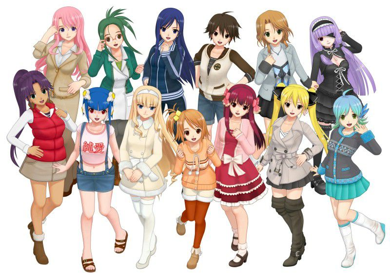
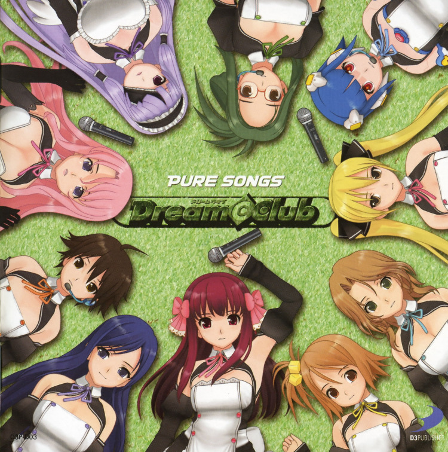
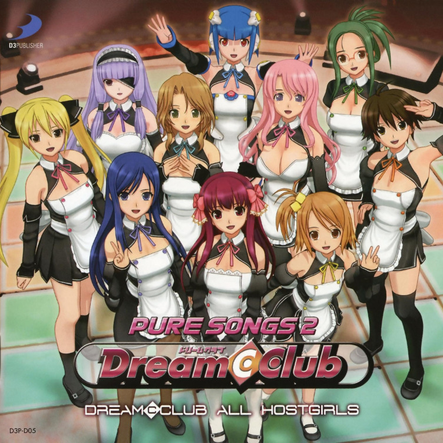

## Dream C Club karaoke files

### For people with pure hearts

A simulation ADV series active from 2009 to 2014 on PS3, PSP, Vita, and Xbox. You assume the role of an average Joe that wins a year-long membership to the coveted Dream Club, where pure-hearted maidens look forward to chatting and drinking with you. The goal throughout the series is to pursue a legitimate relationship with one of the hostesses by the end of the membership period. Every hostess has their reasons for working there as well as friends that the player should maintain good relationships with to become closer to the chosen love interest.

 Translated materials and discussions exist but are sparse and mostly forgotten. I like the music, generic as it may be, so I ripped as many karaoke files as I could find.

### Short ver. Karaoke files

Ripped from **Dream C Club ZERO Special Edipyon! (PS3, 2013)**, **Dream C Club (XBOX360, 2009)**, and **Dream C Club Gogo. (PS3, 2014).** While these files have been converted to .WAV, none not stored in high quality. Real, ripped from the XBOX360 DLC, was the only exception to this for some reason, either an oversight or how the DLC was distributed when the user downloaded it.

[LINK TO MEGA FOLDER](https://mega.nz/folder/dt9VELCD#awrvwRFEV8ajfztlPWheNA)

### Other resources

+ Dream C Club Jouhou
    + A real resource, has a translated guide for operating Host Girls on Stage, a sandbox 'live viewing' title
+ YouTube- Dizzy Ziddy's Event translation playlist
    + Mostly Nonono from ZERO
+ YouTube- nya-1219's song streams/translations
    + This person's channel has a ton of random clips, all of the Dream C Club ones are hardsubbed by him.
+ Niconico- Radio Dream C Club, episodes 1-66
    + Radio hosted by Mizuhashi Kaori (Setsu), includes short DCC drama intro before transitioning into a typical radio show with the guest, usually another DCC voice actor.

<section class="card-gallery">
    

        
            <a href="https://mega.nz/file/pwsAQawQ#of7gWostxbOzFC8gxcftBXZRkfoCj3dKbBivyIR_s6g">
                
PURE SONGS @ DREAM C CLUB (MP3)

            </a>
    

    

        
            <a href="https://mega.nz/file/ht0CzQKA#c6UEnYHPA9pM-tPhSYmwltIsrOyui3ul4VCEFCyB1jg">
                
PURE SONGS 2 @ DREAM C CLUB (MP3)

            </a>
    

</section>